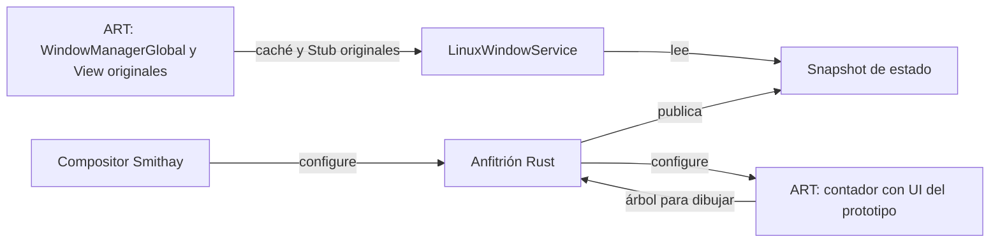

# Consultas IWindowManager respaldadas por Wayland

El anfitrión Rust publica el estado de su ventana después del primer configure
Wayland y de cada configure posterior. LinuxWindowService implementa el contrato
IWindowManager original sobre ese estado. La prueba usa ServiceManager.initServiceCache
y Stub.asInterface originales para recuperar el mismo endpoint local.



## Superficie implementada

| API original | Estado del anfitrión utilizado |
| --- | --- |
| getInitialDisplaySize | Tamaño del primer configure de esta ventana |
| getBaseDisplaySize | Tamaño del configure más reciente |
| getInitialDisplayDensity / getBaseDisplayDensity | Densidad fija 160 del display virtual de la aplicación, buffer scale 1 |
| hasNavigationBar | Capacidad del display virtual: el frontend actual no proporciona una barra SystemUI Android |
| useBLAST | Capacidad del backend actual Wayland/SHM: false |
| getCurrentAnimatorScale | Política del host: ARCHTV_APK_ANIMATOR_SCALE, valor por defecto 1, rango finito 0–10 |

Se admite únicamente el display virtual 0 de esta ventana. No son las métricas
del monitor físico ni soporte HiDPI. La escala de animación es una política que
puede consumir el framework; su lectura no acredita animaciones implementadas.

Los 133 métodos del contrato se conservan. generate_linux_window_service.py genera
siete getters respaldados por el estado y 126 métodos que lanzan
UnsupportedOperationException. --check verifica el archivo generado contra el
binding fijado. Los tipos todavía no portados pueden fallar por enlace antes de
entrar en un método no soportado. Se incorpora Point original, elevando el
conjunto experimental a 83 fuentes Java originales.

## Transporte y vida del proveedor

window-policy.properties es un snapshot ASCII versionado, publicado mediante
rename atómico con modo 0600. Un flock exclusivo sobre window-policy.lock evita
que dos anfitriones usen simultáneamente el mismo directorio. El inode del lock
permanece para impedir carreras al desbloquear; el kernel libera el bloqueo al
terminar el proceso. Se limpia el temporal reservado para el PID al iniciar.

Cada snapshot incluye PID, instante de inicio de /proc, generación, dimensiones
iniciales/actuales y políticas. El consumidor comprueba esquema, límites y vida
del productor, y fija su identidad y geometría inicial al conectarse. Rechaza
regresiones de generación o sustitución del productor. El snapshot se elimina en
el cierre normal; tras una terminación abrupta puede permanecer y se rechaza por
la comprobación del proceso.

El servicio vuelve a leer el estado al consultar. Si el proveedor desaparece o el
registro falla, cierra el endpoint local, notifica sus receptores de muerte y
lanza DeadObjectException. La detección probada ocurre en la siguiente consulta;
no es un aviso asíncrono del driver Binder. Este transporte local recibe una ruta
confiada del anfitrión; aislamiento por UID, autenticación de aplicaciones y el
transporte de operaciones de ventanas siguen pendientes.

## Prueba real

La prueba anida el compositor propio en Weston headless. Ejecuta la APK del
contador con su interfaz de regresión y, en otro proceso ART, el servicio con
Context/Application/Resources originales y los 18 recursos de sistema. Ese
proceso llama las API IWindowManager a través de la caché y el Stub originales.

Se verifica 960×540 → 800×450, tamaño inicial conservado, densidad 160, capacidades
Wayland/SHM, política de escala 0.5, display inválido y API no soportada. El frontend
Rust publica ambos tamaños a partir de los configures reales. Después se termina
el compositor y la consulta al proveedor muerto produce DeadObjectException y un
único callback de cierre. El contador sigue dibujando frames de ambos tamaños.

En la primera configuración se intenta también new View con el mismo servicio
precargado. WindowManagerGlobal ya resuelve window y avanza hasta ValueAnimator,
aún ausente. El constructor falla explícitamente allí. No se repite el constructor
para evitar confundir una inicialización global parcial con un resultado válido.

El servicio se prueba en un proceso ART separado del runtime de la APK. El
bootstrap de ese servicio en Main y las operaciones de creación, sesiones,
entrada, dibujo y permisos todavía no están integrados. La interfaz visible del
contador sigue usando Activity/View propios. El DEX del probe incluye los
adaptadores de contexto existentes y su SharedPreferences de enteros, sin copiar
Activity/View ni widgets propios sobre las clases originales.

## Construcción y ejecución

```sh
CARGO_TARGET_DIR=/home/tv/.cache/archtv/smithay/target CARGO_BUILD_JOBS=1 \
  cargo build -p archtv-apk-host
python tools/apk/build_aosp_queue.py --with-views \
  --sources /home/tv/.cache/archtv/aosp-framework-study/pinned \
  --reference /home/tv/.cache/archtv/aosp-compile-tools/android-all-13.jar \
  --tools /home/tv/.cache/archtv/apk-build-tools --output dist/apk/window-framework-new
python tools/apk/build_window_service_probe.py \
  --aosp-build dist/apk/window-framework-new --bindings dist/apk/window-aidl-3 \
  --tools /home/tv/.cache/archtv/apk-build-tools --output dist/apk/window-service-new
sudo -n systemd-run --unit=archtv-window-service-check --collect --wait --pipe \
  --property=User=tv --property=KillMode=control-group \
  python /home/tv/repositorio-principal/tools/apk/verify_wayland_resize.py \
  --target /home/tv/.cache/archtv/smithay/target \
  --runtime-dex /home/tv/repositorio-principal/dist/apk/apk-system-resource-adapter-2/dex/classes.dex \
  --linux-library /home/tv/.cache/archtv/smithay/target/debug/libarchtv_aosp_linux.so \
  --resources-library /home/tv/repositorio-principal/dist/apk/androidfw-system-assets-2/libarchtv_resources_linux.so \
  --window-service-build /home/tv/repositorio-principal/dist/apk/window-service-new \
  --window-framework /home/tv/repositorio-principal/dist/apk/window-framework-new \
  --window-bindings /home/tv/repositorio-principal/dist/apk/window-aidl-3 \
  --window-system-resources /home/tv/repositorio-principal/dist/apk/system-resources-3 \
  --output /home/tv/repositorio-principal/dist/apk/window-check-new
```

Los destinos deben ser nuevos. La prueba necesita sockets reales del host; la
unidad temporal garantiza limpieza de procesos. AOSP-SERVICIOS-LOCALES.md y
AOSP-RECURSOS-SISTEMA.md describen los builds previos referenciados.

También pasa cargo test -p archtv-apk-host: exclusión de un segundo productor,
conservación del snapshot del primero, eliminación al cerrar y reapertura tras
liberar el bloqueo. Logs, snapshots, hashes, procedencia y frames están en
reports/aosp-window-wayland/. No acredita estabilidad prolongada, transporte
Binder IPC, un WindowManager completo ni el port final de View.
