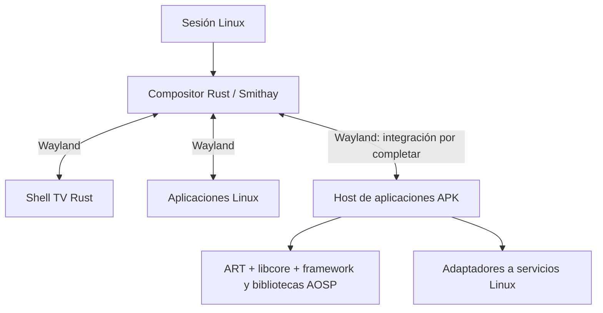
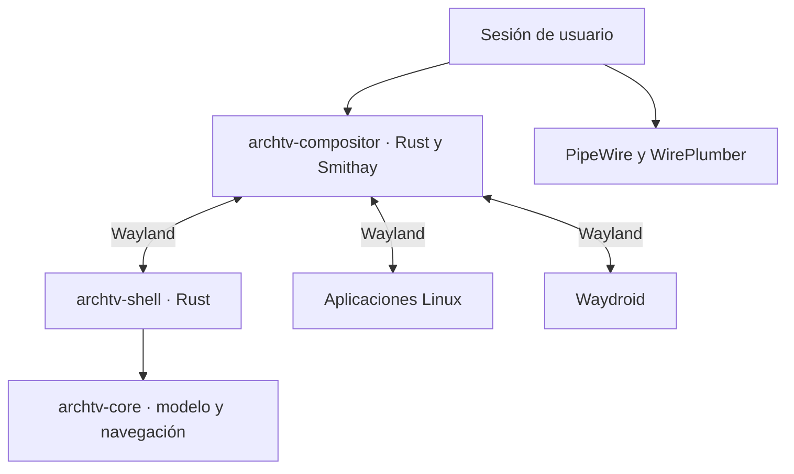

# Arquitectura vigente

Esta sección sustituye las decisiones antiguas de backend Android que se conservan
al final como historia. Estado operativo: [ESTADO.md](ESTADO.md). Requisitos y
aceptación: [ROADMAP.md](../ROADMAP.md). Evidencia: [EVIDENCIAS.md](EVIDENCIAS.md).

El host APK actual combina código original y un prototipo de API propia. La
ventana del contador se representa desde su árbol propio; construir/layout de
View AOSP en otro proceso no demuestra que esa vista dibuje la APK. La flecha
APK del diagrama es el diseño objetivo, no una integración completa acreditada.

| Decisión vigente | Justificación/evidencia | Trabajo abierto |
| --- | --- | --- |
| Compositor y shell Rust separados | Política TV y recuperación H4/H5; evitar bloquear el bucle gráfico con servicios. | Medición H7, mandos físicos y accesibilidad. |
| Reutilizar ART/libcore y lógica original AOSP cuando corresponda | DEX, cola, recursos y perfiles nativos existentes; ver índice. | Decidir conjunto coherente de runtime/framework/servicios y ABI. |
| Adaptar fronteras Linux/Wayland | El producto usa Smithay, PipeWire y servicios Linux. | Gráficos APK, lifecycle completo, permisos e IPC/servicios necesarios. |
| Activity/widgets/árbol propios son experimentales | Sirven al contador y sus regresiones, no prueban compatibilidad general. | Evaluar sustitución por componentes originales; no extenderlos por inercia. |
| Sin Waydroid ni boot Android completo | Restricción del objetivo original y reconducción del usuario. | Reutilizar servicios/componentes no obliga a lanzar una imagen Android. |
| Identidad/aislamiento por APK siguen pendientes | UID Linux 1000 puede colisionar con SYSTEM_UID Android; consultar permisos denegados no impone aislamiento. | Modelo de usuarios/capacidades y defensa antes de APK no confiables. |

## Revisión de reutilización · 30 de octubre de 2026

El [informe de artefactos](../reports/arquitectura-apk-20261030/compatibility-matrix.json)
y [la comparación DEX](../reports/arquitectura-apk-20261030/dex-classspace-comparison.json)
separan observaciones estáticas, enlace de clases y ejecución. La matriz humana
está en [COMPATIBILIDAD-APK.md](COMPATIBILIDAD-APK.md).

| Frontera | Reutilización/adaptación actual | Decisión y evidencia |
| --- | --- | --- |
| Ejecución DEX | ART/libcore host del bundle R8 verificado. | Conservar como laboratorio. No confundir ART con toda la plataforma Android. |
| Framework Java | Perfil selectivo original más Activity/widgets/vistas propios. | Congelar ampliación de esos sustitutos; evaluar el framework DEX original coherente del mismo bundle. |
| Bootstrap | Main crea Application predeterminada y llama hostCreate/hostDestroy sobre Activity propia. | No respeta aún Application declarada ni todo el lifecycle/LoadedApk/providers. Resolver el lanzamiento original como subsistema. |
| Gráficos | Skia/HWUI/Minikin originales y puente Wayland propio; UI del contador basada en árbol propio. | Conservar Skia/HWUI y adaptar presentación/entrada. No reconstruir el catálogo de widgets Android en Rust ni interpretar APK como una pantalla propia. |
| Servicios | Cola/log/recursos y contratos originales; registro local de prueba sin commit. | Adaptación Linux válida como experimento local, no sustituto completo de Binder/servicemanager/PackageManager. Evaluar servicios AOSP originales por conjuntos y sus IPC necesarios. |
| Preferencias/archivos | Backend propio de enteros para fixture. | No ampliarlo como SharedPreferences/almacenamiento Android general; evaluar implementación original y permisos/volúmenes/URI con el recorrido real. |
| ABI nativa | Bibliotecas host glibc. | No cargan automáticamente las bibliotecas Bionic de una APK: comprobar linker, ABI, símbolos, TLS y dependencias, no renombrar libc. |

### Evidencia que cambia la ruta del framework

El bundle oficial R8 registrado en reports/a1-art-host/source.json contiene
framework.jar (37.051.014 bytes; cuatro DEX), services.jar y framework-res.apk.
No son android-all/Robolectric. El inventario de candidatos guarda sus hashes;
queda por confirmar la revisión exacta de cada build y el conjunto completo de
bootclasspath/módulos antes de distribuirlo.

El framework.jar define 26.676 tipos frente a 518 del perfil selectivo examinado.
Markor referencia estáticamente 789 tipos Android externos a su APK; 688 no están
definidos en el perfil selectivo y 39 no están en ese único framework.jar.
Calculator: 594/495/30; VLC: 893/793/40. Esos números no incluyen reflexión ni
resolución de miembros. Algunos tipos pueden estar en otros módulos/boot jars o
ser API más nueva guardada por comprobaciones de versión: no equivalen a fallos
de ejecución ni a un porcentaje de compatibilidad.

El [ensayo ART](../reports/arquitectura-apk-20261030/framework-space/result.json)
usa únicamente framework.jar, la APK original y un probe de reflexión, sin las
clases Android del prototipo. Enlaza Application, Activity, View, LayoutInflater
y las Activity de Markor/Calculator con Class.forName initialize=false; ambas son
subtipos de Activity original. No ejecuta Application/onCreate ni dibuja nada.
La decisión es probar este conjunto coherente en el bootstrap real, conservando
el perfil selectivo como regresión, no seguir cerrando clases ausentes una a una.

### Bionic, libhybris y servicios originales

Bionic incluye libc, libm, libdl y el enlazador Android; su [documentación original](https://android.googlesource.com/platform/bionic/+/master/README.md)
explica su reparto. Las bibliotecas x86_64 de VLC declaran libc.so/libdl.so/libm.so
más liblog/EGL/GLES; el holder host declara libc.so.6/libm.so.6 y libc++ host.
REA identifica notas Android y el hash ELF; readelf registra DT_NEEDED por separado.
Compartir ISA no resuelve esa frontera ABI.

Se compararán dos experimentos antes de fijar la entrega nativa: un entorno de
proceso Bionic coherente con ART/bibliotecas originales y un adaptador de carga
sobre el host glibc. [libhybris](https://github.com/libhybris/libhybris/blob/master/README.md)
es candidato para bibliotecas Bionic/abstracción de hardware; su documentación
requiere adaptaciones y servicios específicos. No proporciona por sí mismo ART,
framework/lifecycle de APK ni traducción ARM, y no se instala como supuesto remedio.
Su utilidad debe probarse con bibliotecas concretas y sus dependencias.

Tampoco se deduce que haya que arrancar Android: se pueden reutilizar bibliotecas
y procesos/servicios necesarios sin SystemUI, SurfaceFlinger ni init de un Android
completo. Queda por demostrar qué servicios originales pueden ejecutarse aislados
con sus dependencias. El registro local experimental no ofrece IPC entre procesos,
callbacks de registro, administración de paquetes ni seguridad Android completa;
no debe crecer por inercia hasta reimplementar todo servicemanager.

### Arquitecturas y aislamiento

Los tres casos adquiridos tienen ruta x86_64 o no incluyen JNI propio. No requieren
traducción de ISA para este primer estudio. [ART Native Bridge](https://android.googlesource.com/platform/art/+/refs/heads/main/libnativebridge/README.md)
es una interfaz y AOSP no incluye un traductor real. [QEMU user](https://www.qemu.org/docs/master/user/main.html)
permite estudiar procesos de otra ISA y traducción de syscalls, con límites de
hilos/namespace e ioctl: no equivale a cargar una biblioteca ARM en ART x86_64.
Para APK sólo ARM hay que evaluar puente y linker invitados o proceso ART de la
ISA invitada. Rendimiento, Binder/gráficos y redistribución quedan sin demostrar.

Antes de ejecutar recorridos completos se debe comprobar aislamiento real de
archivos/procesos/IPC/red y la identidad por APK. Conservar UID Linux 1000 puede
activar ramas SYSTEM_UID de AOSP; devolver permisos denegados no corrige ese
problema ni protege recursos. No se fingirá un UID o un permiso para avanzar.
La solución de identidad debe medirse junto con el backend de servicios.

### Prioridad de ejecución

Primer recorrido propuesto: Markor sin modificar, nota local → edición con teclado
→ guardar → cerrar → reabrir. No tiene .so en lib/ según el inventario; la carga dinámica no está descartada y depende de
servicios/bibliotecas del framework. Después Calculator (alias de lanzador,
widgets e historial) y VLC (JNI, audio/vídeo/foreground services). Para cada caso
se registran lanzamiento, interfaz, entrada, persistencia, servicios y cierre por
separado. Ampliar a WebView, ARM, splits y servicios propietarios sigue requerido;
no se redefine compatibilidad amplia como esos tres recorridos.

Siguiente acción: verificar la procedencia/bootclasspath del framework candidato
y ensayar bootstrap original de Application/Activity, permisos e integración de
ventana en un proceso aislado. No arrancar Waydroid ni un Android completo.
Mantener H7–H9/A3–A5 abiertos: instalar/actualizar/recuperar el runtime y medir
estabilidad/ligereza del producto siguen siendo puertas de salida.

## Antecedentes históricos (no son decisiones vigentes)

La arquitectura anterior queda conservada a continuación para interpretar las
pruebas H6. Sus afirmaciones de Waydroid como backend inicial, paquetes aún no
creados y estado H5 son históricas y no prevalecen sobre la sección anterior.

### Arquitectura objetivo anterior

Estado: compositor, núcleo de foco, supervisión y cliente de prueba implementados;
shell de televisión implementado y en validación H5. El alcance inicial es un equipo
x86_64 UEFI, un monitor y una aplicación principal a pantalla completa.

| Componente previsto | Responsabilidad | Límite |
| --- | --- | --- |
| archtv-compositor | DRM/KMS o backend de pruebas, superficies, frames, asiento, entrada, foco y activación. | Sin catálogos, red ni carga de imágenes en su bucle crítico. |
| archtv-shell | Inicio, tarjetas, favoritos, búsqueda, teclado en pantalla y paneles. | Cliente Rust reiniciable; su fallo no debe cerrar las aplicaciones. |
| archtv-core | Modelo de aplicaciones, estado persistente y navegación espacial. | Lógica comprobable sin GPU ni sesión gráfica. |
| archtv-session | Arranque, supervisión, entorno y recuperación. | Usuarios y servicios se gestionan mediante las herramientas del sistema. |
| Waydroid | Contenedor, imagen y ejecución Android. | Su estado se informa al shell sin bloquear el inicio. |

Los nombres describen responsabilidades. El compositor y el núcleo existen como
crates; todavía no hay paquetes instalables del producto. La supervisión reside
en el compositor y el entorno se valida con una sesión PAM temporal.

## Decisiones iniciales

- Conservar la identidad Arch TV y la referencia de Fire TV 2026 con navegación superior.
- Rust para el compositor, la interfaz y el modelo. Smithay es la biblioteca del
  compositor; Anvil se estudia como referencia y Smallvil como ejemplo mínimo.
- Shell separado para contener fallos. Evaluar Smithay Client Toolkit y una ruta
  de dibujo/texto CPU para el shell, con un ensayo antes de fijar dependencias.
- Pantalla completa y retorno Inicio como política principal; escritorio flotante,
  varios monitores y Xwayland no son requisitos de la primera entrega.
- Seleccionar protocolos y backends explícitamente. Una opción de compilación
  habilitada no equivale a una ruta de presentación probada.
- La sesión propia arranca como usuario normal y retira capacidades heredadas
  innecesarias. La prueba previa identificó CAP_WAKE_ALARM como origen de un
  conflicto con bubblewrap; conservar esta comprobación en la nueva sesión.

## Entrada y control

Inicio se reserva para recuperar el shell. Las flechas y Volver se entregan al
cliente activo cuando no hay un panel propio abierto. El estado de foco recuerda
fila y tarjeta y se restaura al retornar de una aplicación.

El canal de control de la sesión identifica al shell mediante una conexión
privada heredada; se entrega junto con una conexión Wayland con rol de shell. No exponer
lanzamiento de procesos ni gestión de servicios a cualquier cliente Wayland.
Las acciones de volumen, red y suspensión se ejecutan fuera del bucle de frames.
Gamepad, mandos Bluetooth y HDMI-CEC requieren pruebas e integración específica.

## Dependencias compartidas

Mesa, Wayland, libinput, DRM, libseat y las bibliotecas de texto/imagen se evaluarán
según los backends elegidos. PipeWire, NetworkManager y Waydroid siguen siendo
servicios del sistema. Las bibliotecas GTK que necesite Waydroid no convierten
la interfaz propia en una aplicación GTK.

Los hitos y criterios que validan estas decisiones están en [ROADMAP.md](../ROADMAP.md).

## Evolución del entorno Android

La dirección futura es un entorno propio basado en AOSP, compartiendo el kernel
Linux e integrado con Rust/Smithay. Waydroid sirve de backend inicial y referencia
funcional. El contrato de aplicaciones deberá permitir sustituirlo sin rehacer
el shell. Véase [AOSP-NATIVO.md](AOSP-NATIVO.md) para etapas, requisitos de ART,
Binder/framework/HAL, ABIs y criterios para retirar la dependencia.
