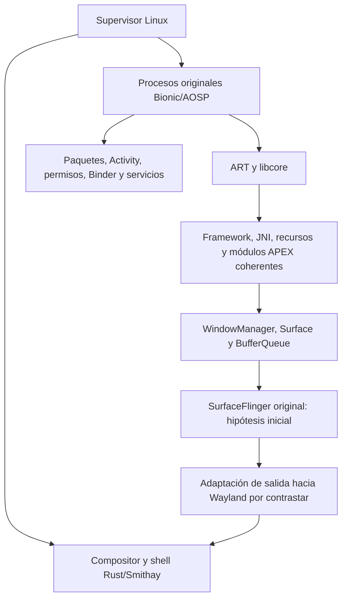
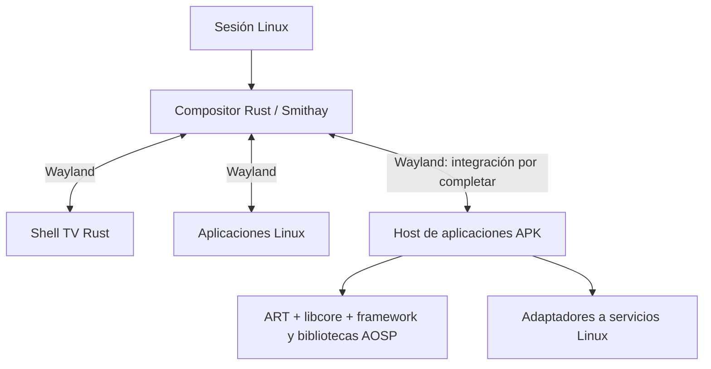
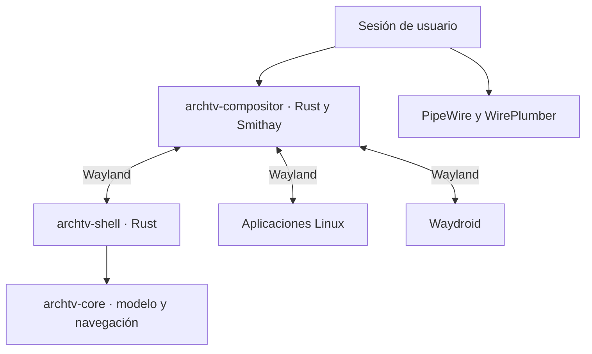

# Arquitectura vigente · A16-QPR2-1

Esta revisión aplica el [contrato del usuario](CONTRATO-APK.md) recibido el
2026-10-30 y sustituye BASE-AOSP-1. Objetivo: plataforma general para APK completas
sin modificar, incluidas Android TV, en nuestro Linux/Rust/Smithay; sin Waydroid,
VM Android ni distribución/imagen Android arrancada. No se eligen sólo aplicaciones
fáciles ni se mantienen adaptaciones particulares por APK como estrategia.
La vía principal **es Bionic/AOSP nativo**; es una decisión contractual, todavía
sin validación funcional de la base nueva. El host Linux puede conservar glibc.

## Base de ingeniería y procedencia

Android 16 QPR2 y `android-16.0.0_r4` están vinculados oficialmente a
`BP4A.251205.006` y `android16-qpr2-release` en el
[anuncio de AOSP](https://groups.google.com/g/android-building/c/WEtw0zEGkLg).
La [tabla oficial](https://source.android.com/docs/setup/reference/build-numbers)
identifica API 36.1 y nivel de parche 2025-12-05. No se confunde esa etiqueta
reproducible con seguridad vigente: identificar/aplicar correcciones y probarlas
es puerta de distribución, con registro de desviaciones sobre la referencia.
No se sigue una rama flotante `android-latest-release` para fijar revisiones.

El [registro de base](../runtime/aosp/android16-qpr2/release.json) conserva
identidad y procedencia. El [manifiesto fijado](../runtime/aosp/android16-qpr2/manifest.lock.xml)
asigna commits a los 1.013 proyectos, con [evidencia por ref](../runtime/aosp/android16-qpr2/manifest.lock.json)
y original intacto. Commit del repo manifest:
`15128c9e27cfa599c48d294babd39286ee8f1426`. La reproducción offline coincide;
objetos commit de diez subsistemas principales se contrastaron adicionalmente.
Esto no es una descarga/build de fuentes ni identifica por sí solo un ZIP
binario. Target/build/configuración/artefactos necesitan comprobaciones propias;
no mezclar compilaciones por compartir API.

El estudio de las fuentes fijadas confirma BUILD_ID y declara el target Cuttlefish
x86_64 TV. El main original de SF inicializa/registra su servicio, hilo Binder y
bucle; sólo es evidencia estática de entrada, no cierre ni puente Wayland.
[Estudio y hashes](../reports/android16-source-lock/source-study.json).

AOSP oficial publica fuentes y targets x86_64; Cuttlefish y Android Emulator son
dispositivos/herramientas virtuales y fuentes posibles de artefactos, no nuestra
arquitectura de ejecución. Android-x86 es otro proyecto independiente. Extraer
artefactos no es arrancarlos. La primera ISA es x86_64; interfaces portables a
ARM64. Compatibilidad 32/64 bits y traducción ARM→x86_64 se prueban aparte.

## Primer artefacto nativo verificado · alcance parcial

La [GSI oficial x86_64](https://developer.android.com/topic/generic-system-image/releases)
`BP4A.251205.006/14401865` coincide con build/API36.1 y SHA-256 publicado.
Se extraen componentes originales sin montar/arrancar la imagen; GSI es una
entrada de investigación, no una distribución adoptada ni autorización de
redistribución. Correspondencia completa de compilador/configuración/fuentes,
licencias por componente y mantenimiento siguen pendientes.

El [ensayo aislado](../reports/android16-native-base/validation.json) ejecuta
linker help/list y ayuda ART. Reutiliza enteros Runtime, ART, I18N, Conscrypt y
StatsD del mismo archivo. ART requiere bibliotecas del APEX StatsD: la selección
inicial de cuatro módulos falló en JNI invocation; incluir el quinto permite ayuda.
No se ejecutó el servicio statsd. El cierre estático de libart encuentra 30 SONAMEs
con candidatos, pero no acredita servicios, namespaces ni carga dinámica general.
`LD_LIBRARY_PATH` aplanado es un diagnóstico explícito, no una frontera aceptada.
La configuración generada del enlazador falta y ART lo advierte; conservarla y
validarla junto con propiedades/APEX/classpaths es la siguiente puerta. Ningún
DEX/APK ni integración gráfica se ha demostrado en este hito.

## Propiedades y configuración · cierre en estudio

[Generadores originales](../reports/android16-original-generators/validation.json):
la adquisición admite archivos regulares con verificación del objeto Git antes
de darles el modo ejecutable original; errores de identidad/presupuesto, enlaces
y sobrescritura se prueban. Aconfig original genera libapexd_flags/libueventd_flags
desde declaraciones y valores de la cadena fuente BP4A, con sus modos originales;
ambos archivos estáticos compilan para Bionic. No se aplica el override habilitado
de trunk_staging. Esto es configuración fuente explícita, no una respuesta de API
ni prueba de equivalencia con la GSI: esos paquetes no están en el inventario
system consultado y su ausencia no establece valores ni ausencia en todo el sistema.

Los minidatos .gnu_debugdata del init original contienen símbolos privados de
PropertyInit/PropertyLoadBootDefaults/StartPropertyService. REA MCP/GDB leyó sólo
una región estática de PropertyInit y cerró sin iniciar inferior; los avisos BFD
de relocalización Android limitan el análisis. Símbolos estáticos no son exports
ni una interfaz ejecutable independiente. No se adopta inyección por direcciones
privadas ni se arranca init; sigue pendiente construir/enlazar la entrada supervisada.

[Bibliotecas de propiedades nativas ejecutadas](../reports/android16-native-property-libraries/validation.json):
ambos módulos originales completos se construyen con clang21, Bionic y libc++ de
plataforma; parser conserva stl:none y ambos conservan -Werror sin includes
adicionales. CRT y lld originales permiten enlazar y ejecutar el wrapper de
metadatos existente, con UID/GID10000, grupos/capacidades vacíos y NoNewPrivs,
usando namespaces del enlazador generados y sin LD_PRELOAD/LD_LIBRARY_PATH.
La dependencia libxml2 del lld anfitrión queda en su directorio privado, fuera
del target. No se pasa ningún objeto glibc a Android.

La generación nativa produce 1.384 entradas/102.112 bytes y se repite con hash
idéntico. Su hash difiere del host en 115 bytes: la comparación completa del
formato original identifica sólo otro orden entre prefijos de igual longitud
del nodo ctl, permitido por el comparator original sin desempate. Los 740 nodos,
contextos/tipos y entradas coinciden al normalizar ese orden; 4.145 consultas
también coinciden mediante lectores originales cruzados. No se alteran los
blobs para forzar el hash host. El rechazo de propietario no root sigue activo.
Esto prueba serialización/lectura nativa de estos metadatos; no PropertyInit,
áreas completas, servicio, mediación SELinux ni compatibilidad APK.

[Dependencias nativas](../reports/android16-native-dependencies/validation.json):
libcap está construido como archivo estático Bionic con sus seis fuentes originales
y ambos encabezados generados por awk/_makenames originales. Se comprobaron los
seis miembros ELF64 x86_64; no se ha enlazado/ejecutado ni validado política de
capacidades por este hecho. SELinux, bootloader_message, lmkd, libprocinfo y APEX
tienen fuentes originales adquiridas; ello tampoco acredita ejecución de servicios.
El intento de adquirir extras completo excedió el límite explícito de 128 MiB:
se conserva incompleto y no se usa. exthandler pertenece a libmodprobe del core
ya adquirido, no exige ampliar ese límite ni inventar una cabecera.

[Construcción original en curso](../reports/android16-libinit-build/validation.json):
se adquirió system/core completo del lock; los 203 archivos regulares de init
coinciden con su extracción independiente. Soong selecciona por defecto
clang-r563880c/21 y libc++ precompilado de plataforma. external/libcxx del mismo
manifiesto conserva cabeceras antiguas para Trusty: estar fijado en el manifiesto
no lo convierte en la implementación de plataforma. No se usa para este target.
Libc++ de plataforma y GSI comparten build-id y hashes de .text/.rodata/.dynstr;
los ELF completos difieren. Esto no demuestra equivalencia total de builds.

El compilador original, verificado contra su objeto Git, produce epoll.o Bionic
x86_64 con cabeceras originales y estándar gnu++20: 5,23s/180.144 KiB RSS para
ese objeto, sin extrapolar al subsistema/runtime. El sondeo previo con hostclang23
cubrió las 52 unidades declaradas: 14 objetos y 38 fallos por cierre/configuración
incompletos, sin excluir fuentes. No acredita libinit construido. Se prepara
protoc25.8/Abseil originales con clang anfitrión/glibc: herramienta de build cuya
frontera son archivos generados, ninguna biblioteca anfitriona entra al target.
El [build original terminó 0](../reports/android16-original-protoc/validation.json):
protoc25.8 generó los tres esquemas init, cuyas fuentes se compilaron para Bionic
con clang21. No se ha enlazado libinit ni ejecutado IPC/persistencia por este hecho.
La sesión69923 es terminal; no relanzar ese build.

El [inventario de entradas completas](../reports/android16-boot-profile/input-audit.json)
verifica dos extracciones independientes: system101, system_ext21 y product58
declaraciones; tres archivos de contextos presentes. El serializador original,
con todos ellos, produce los mismos 102.112 bytes que plataforma sola. No faltan
entradas de esos contextos en el metadato anterior; faltan carga/derivación y
servicio. El auditor sólo inventaría, sin generar propiedades ejecutables.

[Decisión de unidad](../reports/android16-boot-profile/unit-decision.json): evaluar
un entrypoint Bionic supervisado por Linux enlazado con **libinit original completo**.
La fuente declara libinit estático; REA MCP no encuentra exports de PropertyInit,
StartPropertyService o PropertyLoadBootDefaults en init. No hay CLI exclusivo:
no ejecutar second_stage ni inyectar direcciones privadas. El perfil declarativo
que replique algoritmos queda descartado por ahora como implementación del runtime;
la auditoría de procedencia sí se conserva. libinit_host y sus noop builtins no
son un sustituto ejecutable del subsistema nativo.

Es una puerta de construcción, no una integración aceptada: faltan cierre
transitivo/build coherente, callbacks/control con el supervisor, persistencia y
mediación efectiva. Conservar código de init al enlazar no obliga a ejecutar
sus rutas de arranque; hay que demostrar qué se activa y medirlo. No se ha
construido ni ejecutado esta unidad y no se declara compatibilidad APK.

Se reutilizan las bibliotecas originales `libpropertyinfoserializer` y
`libpropertyinfoparser` con soporte host declarado por AOSP, más sus utilidades
originales de libbase. El [wrapper de herramienta](../tools/aosp/property_info_tool.cpp)
sólo genera/consulta metadatos; glibc aquí corresponde al build anfitrión, no a un
port de Bionic ni a una implementación de APIs Android. No se cambia código
original: includes estándar forzados son configuración del compilador. La frontera
host/Bionic aquí es un archivo serializado con el formato original; no se pasan
punteros ni objetos glibc al runtime. ABI/endianness ARM64 siguen sin validar.
[Validación](../reports/android16-configuration/validation.json): siete tests AOSP,
1.384 entradas de plataforma y tres generaciones idénticas; errores de sintaxis,
duplicados y propietario no root rechazados. Contextos de particiones ausentes
no se inventan. Esto no sustituye el servicio ni acredita áreas Bionic.

`PropertyInit`/`StartPropertyService` son APIs internas de libinit; el dispatcher
original no ofrece modo CLI exclusivo para propiedades. Integrar un entrypoint
supervisado exige cerrar callbacks, socket con init, persistencia, propiedades
boot/derivadas y política. Arrancar `second_stage` no se adopta como atajo.
El generador original de namespaces también necesita propiedades/APEX/listas;
`--root` prefija rutas y no importa por sí solo un build.prop.
[Fuentes fijadas](../reports/android16-configuration/source-findings.json).

La [prueba del kernel](../reports/android16-configuration/kernel-property-prerequisites.json)
distingue datos y enforcement: SELinux compilado pero no activo; crear una etiqueta
falla para UID1000 y pasa para UID0. Eso permite explorar bootstrap privilegiado
original, pero no acredita autorización SELinux ni aislamiento de aplicaciones.
La [prueba de áreas Bionic](../reports/android16-property-area/validation.json)
crea áreas con funciones originales, importa el build.prop exacto y lee 101 valores,
incluidos 309 bytes en una propiedad larga. El [wrapper target](../tools/aosp/property_area_probe.c)
es diagnóstico: sólo enlaza Bionic libc.so y símbolos LIBC_PLATFORM; no implementa
propiedades ni ejecuta ART main. El contraste es getprop original sin preload,
que también lee tipos/contextos generados en el host. 364 archivos repiten
contenido en dos escritores; eso no es persistencia de datos de una APK.

Frontera demostrada: setup Linux configura montajes sólo lectura y namespaces
de montaje/PID/red/IPC/UTS/cgroup, limpia grupos, baja UID/GID10000, confirma cero
capacidades permitidas/efectivas y activa no_new_privs antes de exec. Python/glibc
son herramientas del supervisor; el target usa Bionic. No se pasan punteros ni
objetos entre entornos. El escritor bootstrap privilegiado está separado: sin
capacidades falla con EPERM de etiquetado y se aborta el ensayo; sólo se acepta
el snapshot de la ejecución privilegiada. Las aplicaciones no obtienen esos permisos.

El namespace de un solo UID muestra property_info como 65534:65534; el lector
original exige root:root. El intento con mapa completo falla en el cambio de GID
de bwrap y no se acepta. La prueba final conserva identidades Linux reales sin
namespace de usuario. Son funciones y límites de aislamiento, no un Android
oculto ni una aceptación de seguridad general.

El servicio de propiedades sigue ausente. Bionic deriva protocolo antiguo al
faltar ro.property_service.version y devuelve 2/ENOENT sin conexión; las fuentes y
[REA MCP estático](../reports/android16-property-area/rea-property-set-disassembly.json)
separan ese comportamiento de un fallo de ABI. No se añade una versión para
fingir el servidor. Su aceptación futura requiere readback/callbacks/denegaciones,
no sólo retorno 0, incluso donde el protocolo legacy original devuelve 0 tras timeout.

El snapshot no carga todos los defaults/imports/propiedades derivadas de init
ni política de particiones ausentes. SELinux sigue inactivo: tipos y etiquetas
no son mediación. La política/IPC precisa integrar mediación original con Linux
o una adaptación equivalente probada: ninguna se acepta aquí. No se activa
mediante un reinicio bajo este contrato. Sigue APEX/listas/metadatos y generador
original de namespaces, después classpaths/ART; no métodos individuales.

## Namespaces y classpaths originales · ejecución parcial

La [herramienta de preparación](../tools/aosp/prepare_factory_inputs.py) verifica
la imagen fijada y extrae el sistema y sus 36 módulos originales, sin montar ni
arrancar Android. 4.394 archivos originales y el XML derivado se repiten idénticos en dos
extracciones completas. Rechaza espacio insuficiente antes de escribir y errores
debugfs que antes podían dejar archivos vacíos con retorno 0. La extracción no
restaura propietarios: el layout de investigación no es un instalador seguro.
La selección de fábrica usa el esquema A16 con partición explícita; no acredita
apexd, firmas, activación segura ni actualización.
[Evidencia](../reports/android16-linkerconfig/validation.json).

El generador original normal produce configuración base y por APEX; el estricto
dirigido a ART pasa y su archivo coincide con el normal. Estricto global aborta
por libdexfiled.so requerida en system y ausente: no se inventa un proveedor ni
se elimina su requisito. La fuente original permite ignorar requisitos en modo
normal y restringe la validación estricta por APEX a su ámbito. Por eso la salida
normal no demuestra cierre global; hay que reconciliar el build/config original.
[Fuentes y alcance](../reports/android16-linkerconfig/source-findings.json).

La frontera de configuración ya evita aplanar rutas en los ensayos consumidores:
linker list, ayuda ART y getprop funcionan con los namespaces originales generados
sin LD_LIBRARY_PATH/preload. Sólo el bootstrap del generador usó rutas explícitas;
no se adopta esa excepción para las aplicaciones. Sigue siendo UID10000 sin
capacidades con credenciales comprobadas antes de exec, no un Android iniciado.

derive_classpath original consume sus fragmentos/properties sin overrides y
genera 46 entradas BOOTCLASSPATH, 14 DEX2OATBOOTCLASSPATH, 14 SYSTEMSERVERCLASSPATH y 9
jars standalone. Los 69 jars únicos contienen DEX y pertenecen al mismo GSI;
no se sustituyen por stubs SDK ni clases propias. La regresión DEX preexistente
(pura Java, referencia API28 sólo de compilación) pasa en ART16 con ese BCP46:
no hay runtime Android13, ART host o glibc dentro del proceso target.
Eso verifica ejecución del motor, no APIs Android completas, JNI de una APK,
servicios, UI, instalación ni compatibilidad general. Los classloaders de
paquetes/splits siguen pendientes.

La siguiente unidad para Markor será el arranque original app_process/AndroidRuntime
y sus registros JNI, Binder/identidad y la clausura de servicios. System_server
no se presupone separable ni aceptado por iniciar una clase; sus dependencias y
cualquier conflicto con el contrato se estudian antes de arrancar conjuntos.
La semántica de propiedades/IPC, mediación SELinux y el fallo estricto global
permanecen puertas abiertas, junto con SF/Wayland y las nueve etapas reales.

## Entrada de framework y configuración de producto · puerta abierta

La [auditoría](../reports/android16-framework-entry/provider-audit/audit.json)
reconcilia metadatos, no implementaciones: el JSON original requiere libdexfiled.so
sin condición; de 41 requisitos de sistema es el único sin proveedor declarado
entre system/APEX. La biblioteca no está presente. Se conserva el fallo estricto
global; el modo normal que ignora requisitos no convierte esa ausencia en éxito.

El [ensayo app_process](../reports/android16-framework-entry/validation.json)
usa código original, JNI/framework y classpaths del mismo build bajo UID10000
sin capacidades. El retorno 0 no acredita arranque: AndroidRuntime.start es void
y retorna cuando falla startVm/startReg; main no propaga esos errores.
La captura mediante API original liblog muestra el guard
ro.product.cpu.abilist64 vacío antes de JNI_CreateJavaVM. No se registraron los
JNI Android ni se alcanzó ActivityThread de forma demostrada.

[Instrumentación](../tools/aosp/native_log_diagnostic.c) sólo selecciona el logger
stderr original y su prioridad; no reemplaza JNI, permisos ni servicios. El
namespace rechazó la biblioteca bajo /probe; se usó /data ya permitido, sin
cambiar configuración. Es un preload diagnóstico separado: retirar de aceptación
funcional. REA MCP ha inspeccionado estáticamente el startVm compilado; ejecución,
fuente e inferencias permanecen evidencias distintas.

La carencia es una unidad de configuración, no una función Java a simular:
PropertyLoadBootDefaults original carga particiones en orden, procesa imports y
defaults y deriva identidad/ABI/fingerprint/vendor API. Nuestro snapshot de 101
valores es sólo system; quedan sin aplicar 21 de system_ext y 58 de product, además
de derivaciones y entradas hardware/boot. Se estudia primero la unidad completa
y su cierre: PropertyInit/StartPropertyService no se exponen como una CLI aislada,
y ejecutar init second_stage no se admite como atajo.

La siguiente comparación será reutilizar una entrada nativa de la unidad original
o preparar un perfil de producto declarativo propio de Linux con artefactos
originales. No hay opción aceptada/implementada aún. Cada campo debe indicar
original, derivado con regla/fuente, definido por Linux o desconocido; los imports
o particiones ausentes no se completan con valores inventados. Separar ABIs
candidatas del artefacto, ISA/backend realmente probado y JNI/API de aplicaciones.
No anunciar ARM/traducción, 32 bits, hardware seguro, verified boot, GMS/certificación
o servicios activos por declarar una propiedad. La política y el servidor real
de propiedades siguen siendo puertas independientes.

Aceptación de esa unidad: entradas/configuración reproducibles y trazables,
validación de contexto/tipo con originales, errores explícitos, capacidades/ABI
honestas, e inicio original que avance más allá del guard observado. Un retorno 0
o un log no bastan; después repetir sin instrumentación y recorrer la aplicación.
Preservar los namespaces y evitar cambios internos de AndroidRuntime para omitir
sus checks.

El ActivityThread directo no zygote sólo fue un diagnóstico de prerrequisitos:
Markor intacto estuvo en CLASSPATH, sin prueba de instalación/carga/ejecución.
La ruta APK real debe estudiar paquetes, fork/zygote o alternativa equivalente
justificada, ActivityManager y callbacks originales. app_main muestra el pool
Binder y ActivityThread llama attachApplication en AMS; son rutas de fuente,
no servicios arrancados. No se ha iniciado zygote/system_server ni Android completo.

## Subsistemas y fronteras elegidas



| Decisión | Motivo/evidencia disponible | Cambio propio permitido y dependencia pendiente | Aceptación |
| --- | --- | --- | --- |
| Conservar Bionic/linker/ART/libcore/framework/JNI/APEX/recursos de una base coherente | Contrato; experimentos Android13 mostraron coste de mezclas host y configuración omitida, no aceptación de Android16 | Configurar entorno original; modificar interiores sólo con necesidad demostrada y desviación registrada. Falta cierre de runtime A16 | Motor y configuración originales, identidades/ABI/classloaders, después recorrido real |
| Conservar unidades funcionales grandes si dividirlas cuesta más o reduce semántica | Paquetes, permisos y lifecycle tienen dependencias reales; el parser antiguo falló por PermissionManager ausente | Evaluar servicios y agrupaciones originales, incluido alcance real de system_server; no asumir separación fácil ni vaciar respuestas | Inicio/operación/error/callbacks/persistencia/concurrencia/cierre e IPC de la unidad y aplicaciones |
| Frontera Android/host explícita | Glibc y Bionic no son intercambiables; el host ya usa Rust/Linux | Preferir límites de proceso y protocolos versionados para memoria/FD/buffers/identidad. Fronteras híbridas sólo con prueba | Propiedad, lifetime, credenciales, revocación y recuperación verificadas; no objetos C++/JNI compartidos por suponer misma ISA |
| SurfaceFlinger hacia Wayland primero | Nueva hipótesis contractual; conservar semántica gráfica en vez de reconstruirla por suponer incompatibilidad | Estudiar HWC/RenderEngine/allocator/sync y puente de salida; Smithay mantiene pantalla/foco/dispositivos del host | Interfaz APK real, buffers/fences/aceleración/escalado, ventanas y entrada; no basta captura o menú |
| Instalación/actualización como subsistema completo | APK, splits, firmas y selección ABI forman el comportamiento de plataforma | Supervisor/almacenamiento Linux y empaquetado; no confundir AAB con APK ni parchear apps | Instalar/actualizar/migrar/desinstalar, fallo/rollback y conjunto firmado coherente |
| Android13/host sólo referencia histórica | Conserva regresiones y evidencia de costes, pero otra API/build/classloader | Se pausa su ampliación; no sustituir aún sus fixtures/compositor ni mezclar sus jars/JNI con A16 | Comparación etiquetada; reemplazar sólo con resultados de base nueva |

El anfitrión conserva arranque, supervisión, dispositivos, escritorio y composición
Linux. Se permiten procesos AOSP necesarios: su nombre o presencia no equivale
por sí solo a Android completo. No se arranca Android init/una imagen ni se oculta
un SO Android bajo el shell. Si el cierre de una unidad exige ese entorno, registrar
el conflicto real antes de cambiar el alcance. No se decreta que eliminar Zygote,
system_server o SurfaceFlinger sea fácil o requisito por sí mismo; se mide el
conjunto ejecutado y quién conserva el control del sistema. Los namespaces se
describen por su función real, sin sustituir pruebas de aislamiento.

## Cierre y comportamiento que hay que conservar

Antes de implementar: inventario de repositorios/build/artefactos; bootclasspath,
classloaders y namespaces; APEX/configuración generada; propiedades, Binder y
requisitos del kernel; permisos/identidad/datos; servicios y dependencias transitivas.
El número de versión del kernel Linux no demuestra las interfaces Android necesarias.

No se reimplementa ART ni se porta código Android a glibc por defecto. Se reutilizan
bibliotecas/procesos originales cuando puedan ejecutarse; no se usan stubs SDK como
framework. Cada modificación interna registra motivo, archivo/revisión original,
diff, dependencia y regresión. Las ausencias fallan explícitamente y con traza.

Los subsistemas incluyen instalación/firmas/componentes, Activity/ventanas y muerte
de procesos, Binder/identidad/permisos/IPC entre apps, recursos/almacenamiento/URI/
intents, servicios/notificaciones/trabajos/segundo plano, callbacks/concurrencia/
errores/persistencia. No se resuelve sólo el método que desbloquea un constructor.
El diagnóstico sigue las siete fases del contrato y comprueba beneficio para otra
aplicación sin un parche por APK.

## Gráficos, TV y multimedia

Primer experimento gráfico: SurfaceFlinger original componiendo la salida Android
que se presenta mediante Wayland a Smithay. Hay que estudiar la interfaz de salida
(HWC/virtual display u otra adaptación demostrada), buffers/formatos, ownership y
fences; todavía no se elige una implementación de puente ni se afirma que funcione.
Alternativas se comparan cuando existan costes o fallos concretos, no por excluir
SurfaceFlinger de antemano. Su proceso no controla el escritorio Linux.

Probar aceleración, composición, ventanas, escalado y foco con teclado, ratón,
táctil y mando/D-pad. Audio/vídeo: codecs, audio focus/rutas, superficies y sincronía
AV con reproducción real y cierre. Android TV añade resolución de actividades TV,
features/manifest, navegación y funciones específicas. Apariencia Fire TV no implica
compatibilidad de APK privilegiadas Amazon/OEM o de sus servicios.

## Ejes independientes y dependencias externas

API/comportamiento/servicios, ABI Bionic/JNI/enlazado e ISA/32/64 bits tienen resultados
separados en la [matriz](COMPATIBILIDAD-APK.md). Comenzar con APK DEX y x86_64; definir
fronteras ARM64 y traducción ARM desde ahora sin afirmar que exista traductor. Respetar
`targetSdkVersion`; las API posteriores a la base requieren evolución explícita.

El catálogo canónico de dependencias ya registra GMS/microG, WebView, proveedores,
media y DRM; se amplía con servicios OEM y apps privilegiadas. Estudiar contrato
real de una app, fuente original y binarios/REA; distinguir reutilización/adaptación/
servicio remoto. Evaluar implementaciones existentes antes de escribir otra, sin
atribuir a AOSP GMS ni a una API local cuentas, licencias, claves, certificación,
hardware seguro o aceptación del backend. No parchear APK para eludir requisitos
y contarlas como compatibles. Interfaces identificadas no son funciones resueltas.

ATL/art_standalone y libhybris conservan interés comparativo para componentes y
fronteras: no son adopción de stubs/widgets propios ni sustituyen la base Bionic
coherente elegida. Sus versiones/licencias y función concreta necesitan pruebas.
El ART host/glibc queda como referencia, con mezclas antiguas documentadas como tales.

## Pruebas, seguridad y entrega

La base nueva se desarrolla aislada de la anterior. Primero cierre Bionic/ART con
configuración original; después Markor completa; luego categorías distintas sin
reconstrucciones particulares. Para cada APK: instalación, lanzamiento, interfaz,
entrada, función principal, persistencia, servicios, cierre y reapertura. Estados:
aprobado, fallo demostrado, bloqueo externo y no probado, sin porcentajes inferidos.
Fixtures sólo regresiones. Referencia Android externa cuando esté disponible; no
se arranca otro Android local ni se reinicia VM/cliente para esta tarea.

CDD Android16 y CTS16.1 son referencias técnicas. Registrar módulos/casos pertinentes
y no ejecutados; ni subconjunto ni informe local equivalen a certificación. Las
puertas abarcan firmas/splits/ABI, UID real por app, permisos/datos/Binder, límites y
recuperación, mediciones RAM/CPU/arranque/latencia/estabilidad sobre hardware conocido,
presupuestos justificados, mantenimiento de seguridad, procedencia/licencias,
instalación limpia y actualización reversible. No conseguir ligereza suprimiendo
comportamiento. [ROADMAP-A.md](ROADMAP-A.md) fija dependencias y aceptación.

## Unidad nativa libinit · evidencia parcial vigente

[Validación](../reports/android16-libinit-native-unit/validation.json): las 52 fuentes
originales compilan con clang21/Bionic y perfil global original. 51 objetos se
reutilizan tras igualdad real del preprocesado y comprobación SHA; init.cpp se
compila al añadir el include exportado original de libxml2. Archivo prototipo de
63 miembros: 52 fuentes, tres protobuf, dos XSD y seis libcap. No equivale a Soong
completo: sanitización/configuración de producto y alineación de flags de los
protobuf siguen abiertas, junto al enlace y ejecución supervisada de PropertyInit.

XSDC original genera el esquema APEX; sus dos fuentes C++ compilan para Bionic.
Rust1.88 original usa su std Android x86_64, sin objetos glibc en target. La FFI
original genfslabelsversion se enlaza y ejecuta en cuatro casos reales: ausente,
válido, malformado y permiso denegado. UID10000, sin grupos/capacidades, NNP1.
El fallback original 202404 no demuestra mediación SELinux. No servidor, boot
Android, aplicación ni etapa de la matriz aceptados por estas pruebas.


## Diagnóstico previo de PropertyInit · superado por el perfil fuente

[Pruebas y alcance](../reports/android16-propertyinit-entry/validation.json):
146 fuentes originales de protobuf/Abseil compilan para Bionic; sus dependencias
cierran el enlace de la entrada supervisada PropertyInit (salida0). Ejecución real
del inicializador original aborta (salida127) por faltar
`/vendor/etc/selinux/plat_sepolicy_vers.txt` en el perfil GSI de sólo sistema.
No readiness, sockets ni APK. El inicializador es UID0 con capacidades root en
namespaces privados; esto no acredita aislamiento de aplicaciones ni SELinux.
Siguiente: contrastar generación y selección original del perfil vendor/política,
sin fabricar valores, omitir comprobaciones o iniciar Android completo.


## Perfil de propiedades y diagnóstico previo de opciones

[Pruebas](../reports/android16-property-profile/validation.json): la regla original
sepolicy_vers y la herencia BP4A derivan el valor202504 del perfil fuente. Con esa
entrada, PropertyInit original retorna0; getprop original lee los mismos170 valores
con UID10000/capacidades0. El inicializador fue UID0, separado del lector. No se
acreditan vendor de hardware, paridad de configuración GSI, sockets ni SELinux.

App_process termina1. REA MCP/GDB observa JNI_CreateJavaVM→Runtime::Create→
ParseOptions→ParsedOptions::Usage→runtime_exit(1): falla al analizar opciones,
antes de disponibilidad de VM. La traza tiene símbolos originales ajustados a
mapeos observados; breakpoint pendiente por sí solo no habría probado esa entrada.
Debugger cerrado e inferior terminado. Próximo paso: estudiar fuentes y lista real
de opciones del arranque; no declarar ActivityThread/Markor ejecutados.


## Puerta vigente: Binder privado y política del Linux anfitrión

[Resultados](../reports/android16-binder-service-gate/validation.json): kernel LTS
6.18.59, Binder Rust integrado y montajes binderfs privados. Dos contextos asignan
dispositivos distintos y responden protocolo8 con UID10000/capacidades0; esto no
prueba transacciones o aislamiento completo. Corrigiendo el conflicto de opciones
del harness, ART original ejecuta RuntimeInit.main y llega a llamar ActivityThread.main
con Binder privado; faltan el gestor de contexto y HIDL. No Markor instalada/ejecutada.

Servicemanager original, con UID/grupos de su rc y sin capacidades, aborta en
selinux_status_open(true). SELinux está compilado pero no está entre los LSM activos.
La [documentación del kernel](https://kernel.org/doc/html/latest/admin-guide/kernel-parameters.html)
describe la selección inicial mediante CONFIG_LSM/lsm=; no confundir una biblioteca
libselinux o un archivo status con política y mediación activas.

Siguiente unidad: integrar la política, etiquetas y transiciones del runtime con
la seguridad del Linux anfitrión, preservando las comprobaciones originales de
servicios. Incluir contextos Binder/HIDL/vendor, gestores, propiedades/VINTF,
identidades por servicio/app y pruebas de registro/descubrimiento/denegación/muerte.
No cargar una política Android aislada como si sólo afectara a una carpeta ni
sustituir comprobaciones por permisos ficticios. El contrato actual impide reiniciar
la VM: preparar y validar fuentes/build/instalación y pruebas independientes;
la activación y enforcement en esta VM quedan pendientes de un arranque permitido.
No se ha cambiado el boot ni arrancado Android.

### Preparación verificable de política y despliegue

`python tools/aosp/check_host_security.py` sólo lee el kernel de la vista de
montajes actual; salida2 significa requisitos incumplidos o desconocidos. No cambia
LSM, política, etiquetas ni arranque. El estado compilado es informativo: se exige
SELinux activo, página status consistente, política cargada/enforcing e interfaces
de clases/permisos Binder, service_manager, hwservice_manager y property_service.
Una captura offline queda identificada como tal. Incluso si pasa, no acredita
semántica de política, servicios, aislamiento ni APK; el runtime sigue utilizando
libselinux original, sin delegar sus comprobaciones a este diagnóstico.

Antes de una política propia se consideran [refpolicy original](https://github.com/SELinuxProject/refpolicy)
y la [integración Arch existente](https://wiki.archlinux.org/title/SELinux), además
de la política AOSP completa fijada. Ninguna está elegida por mera disponibilidad.
Contrastar offline dos bases: política AOSP con integración de dominios Linux, y
base Linux/refpolicy con los contratos AOSP originales incorporados. Fijar revisiones,
clases/orden, MLS, roles/usuarios, tipos/contextos esperados y neverallow; registrar
conflictos sin eliminar reglas para conseguir compilación. Herramientas anfitrionas
originales pueden generar políticas por archivos, sin introducir objetos glibc en
procesos Bionic. Una compilación offline no demuestra carga o enforcement.

[Comparación fijada y ensayos](../reports/android16-policy-base-comparison/validation.json):
refpolicy878b00a2 y AOSP original. No se ha seleccionado política de despliegue.

| Base de política | Evidencia disponible | Adaptación y prueba pendientes |
| --- | --- | --- |
| AOSP con integración Linux | Platform CIL original de GSI compila offline, formato30, neverallow activo;107 clases y contratos Android presentes | No es vendor completo ni política de host validada. Añadir/integrar dominios, etiquetas, SID iniciales, servicios y administración Linux conservando semántica Android; boot, transiciones y denegaciones reales |
| Linux/refpolicy con contratos AOSP | Revisión exacta, baseline MCS/systemd/formato30 y CIL compilan;136 clases contrastadas contra el compilador original | Faltan service_manager, hwservice_manager y property_service; incorporar contratos originales sin mezclar inadvertidamente atributos/roles/usuarios, y probar servicios AOSP |
| Composición de ambas | Control negativo con ambos CIL sin adaptar falla en redeclaración de object_r; Binder comparte cuatro permisos | El fallo sólo descarta la composición global directa. Necesita fronteras justificadas de clases/orden, tipos/atributos, roles/usuarios/contextos y MLS, con herramientas semánticas existentes antes de transformar |

Las clases/órdenes distintos no son por sí solos fallo ABI probado; revisar los
mapeos de kernel/libselinux. Ambas fuentes usan atributos literales domain,
exec_type, file_type, mlstrustedobject y proc_type: el riesgo de unión accidental
requiere contrastar decisiones efectivas, no renombrar a ciegas ni quitar neverallow.
El ensayo con herramientas AOSP cuya libsepol declara3.7 pasa, aunque refpolicy
requiere upstream3.9+; una configuración compilada no acredita toda esa matriz.
No elegir por tamaño del binario ni convertir inventario estático en enforcement.

La decisión necesita después un arranque Linux permitido y recuperable con su
política: boot/servicios Linux funcionales, etiquetas persistentes, transiciones
del supervisor y servicios/app originales, Binder con identidad y denegaciones
reales, caída/recuperación, actualización/rollback. No cargar directamente una
política Android sobre la VM actual ni confundir una carpeta/mount namespace con
una política SELinux independiente. La prohibición actual de reinicio se conserva.

## Investigación R6 separada: Native Bridge y motores existentes

La decisión y evidencia detalladas están en [TRADUCCION-ARM.md](TRADUCCION-ARM.md).
Se conserva el contrato Native Bridge/Native Loader original de nuestra revisión:
soporte de namespaces, zygote, JNI y linker invitado, sin implementar un motor.
libndk_translation y Houdini no están validados para nuestro build ni tienen una
concesión de redistribución del bundle acreditada. QEMU user-mode es una frontera
de proceso experimental distinta del bridge en ART x86_64. Berberis público y el
candidato abierto Digitalis deben evaluarse con fuente/licencias y artefactos fijados.
No se ha demostrado insuficiencia de las opciones existentes: no procede un motor
propio. Esta investigación no altera R1/R1-MAC ni aprueba etapas de APK reales.

## Decisiones offline con herramientas originales

[Evidencias](../reports/android16-policy-semantic-baselines/validation.json): diez
consultas de inventario y catorce consultas de acceso mediante libsepol original:
seis permisos concedidos, tres denegaciones y cinco errores de contexto/clase/permiso.
Los errores no se contabilizan como denegaciones. Un permiso por invocación evita
el límite identificado en el bucle original de argumentos. No hay enforcement
vivo, política compuesta ni aceptación de aplicaciones.

Se descarta usar sepolicy-check como oráculo general: no representa todas las
condiciones efectivas y su máscara de permisos es limitada. seamendc tampoco es
un compositor completo: omite construcciones y nunca debe sustituir las aserciones
neverallow originales. La siguiente unidad debe conservar las fuentes completas,
resolver clases, atributos, usuarios/roles y MLS explícitamente y contrastar
semántica global; catorce casos no demuestran equivalencia. Ninguna base elegida.

## Control experimental de namespaces de política

[Resultados](../reports/android16-policy-namespace-controls/validation.json): el
compilador original rechaza sensibilidad/categorías dentro de bloques. Mover sólo
esas declaraciones al nivel global permite compilar AOSP (salida0 en29,8s tras
un primer límite de25s). Nueve consultas seleccionadas conservan su resultado
con nombres prefijados; no acreditan equivalencia completa. La clase original
service_manager deja de existir y aosp.service_manager no conserva su contrato
de nombre. Usuarios/roles/tipos/contextos también cambian. No es una política
de despliegue ni composición Linux/AOSP aprobada. Siguiente: preservar contratos
Android de clases/contextos y resolver explícitamente los globales MLS/SID y
la integración Linux, conservando todas las aserciones. Nada cargado o reiniciado.

## Integración de política · namespace Linux y conflicto de SID

[Ensayos](../reports/android16-linux-policy-namespace/validation.json): refpolicy
completa compila en namespace Linux con clases/common/MLS y nombres SID globales.
Cinco consultas seleccionadas con clases originales mantienen sus resultados;
no prueban equivalencia completa ni etiquetas/transiciones del host. Una unión
explícita propuesta contiene145 clases y como máximo32 permisos por clase.

El control de composición conserva reglas/aserciones de ambas fuentes, mantiene
nombres Android y separa símbolos Linux; el compilador original lo rechaza
porque un SID inicial no puede tener dos contextos. Hay27 contextos iniciales
literalmente distintos entre las fuentes. La siguiente decisión debe justificar
qué contexto global representa cada SID y cómo conservar la mediación Android
y Linux, junto a restricciones MLS y accesos entre dominios. No eliminar
contextos/asserts para aceptar una compilación. Ninguna política elegida, cargada
o validada con servicios/APK; no se reinició la VM.

## SID y pseudoarchivos: conflicto de etiquetado compartido

[Dos hipótesis ejecutadas offline](../reports/android16-policy-sid-ownership/validation.json):
seleccionar explícitamente los contextos SID originales Linux o AOSP conserva
las reglas y aserciones, pero sustituye27 mapeos iniciales de la otra fuente.
Es una hipótesis de integración, sin equivalencia semántica demostrada. Ambas
fallan después (255) en el procesamiento original genfscon. Se registran29
coincidencias exactas de sistema/ruta/selector con contextos diferentes; no es
un análisis exhaustivo de precedencias y subrutas.

El código original cil_post.c compara sistema de archivos/ruta y rechaza
contextos distintos para la misma clave. Ni namespaces de tipos ni seleccionar
SID separan automáticamente el etiquetado compartido. Debe diseñarse una tabla
global coherente para pseudoarchivos Linux con mediación y accesos Android
explícitos, conservando las comprobaciones; no retirar etiquetas en silencio.
La elección de base sigue abierta hasta probar transiciones/denegaciones y
servicios originales, además de arranque y recuperación del host. No se ha
cargado política ni alterado el arranque de esta VM.

El [proyecto SELinux](https://github.com/SELinuxProject/selinux-notebook/blob/main/src/computing_security_contexts.md)
describe herencia desde el contexto kernel y transiciones de init durante exec;
la política refpolicy fijada define kernel_t/init_t y la AOSP kernel/unlabeled.
Es fundamento de la decisión pendiente, no una prueba de nuestro arranque.

## Conjuntos globales: fallo probado de la composición actual

[Evidencia del compilador original](../reports/android16-policy-global-labels/validation.json):
la hipótesis Linux sustituye explícitamente27 mapeos SID,29 genfscon y18 fsuse
duplicados. Conserva reglas y aserciones originales. Agota90s después de emitir
14 marcadores de fallo neverallow; no hay compilación completa ni total exhaustivo
de infracciones. El control no es una política aceptada.

El namespace de CIL no limita el universo de las expresiones de tipos not/all.
Las definiciones originales linux.base_typeattr_8 (not can_load_kernmodule),
linux.base_typeattr_7 (all) y linux.base_typeattr_6 (not domain/unlabeled_t)
incluyen tipos AOSP, y producen conflictos reales con sus reglas. También se
observan aserciones Android que chocan con reglas Linux. Una búsqueda literal
sólo en líneas neverallow omitía el álgebra de los atributos referenciados y
se conserva marcada como insuficiente, sin convertir su cero en ausencia.

La siguiente composición necesita universos de tipos explícitos y preservación
de la proyección original de cada política, además de comprobar reglas, MLS,
clases y permisos globales y accesos entre ambos lados. No desactivar neverallow
ni declarar equivalencia por conservar textos o unas consultas. Este fallo
descarta la composición actual, no las dos estrategias adaptadas completas.

## Universos explícitos: compilación y límite de mediación

[Resultados reproducibles](../reports/android16-policy-type-universe/validation.json):
las expresiones de atributos se intersectan con1937 tipos AOSP y4590 Linux.
El primer presupuesto180s se agota; el reintento del mismo CIL termina0 en369s
con neverallow habilitado y máximo RSS informado463676KiB. Los límites CPU
configurados y tiempos informados se conservan sin afirmar enforcement exacto
del presupuesto. No se cargó la política.

La exportación original checkpolicy compara todos los atributos retenidos:
199 AOSP coinciden;100 de los340 Linux originales ya faltan en el control
CIL/compilador aislado, y los240 conservados coinciden en la composición.
Esto no prueba equivalencia de los100 eliminados, reglas, restricciones MLS,
transiciones ni decisiones generales. Nueve consultas originales válidas
conservan permiso/denegación. La consulta Linux a service_manager cambia de
error de clase inexistente a denegación porque la unión incorpora esa clase;
no confundir un error antiguo con un permiso original.

Hay un límite demostrado: untrusted_app puede buscar el directorio proc con
la etiqueta Android, pero se le deniega la búsqueda del proc_t Linux global.
La lectura del proc_meminfo original sigue permitida. Compilar con aserciones
no aporta por sí solo mediación de etiquetas compartidas. Resolver accesos
precisos de servicios/apps a recursos Linux preservando denegaciones y MLS;
no conceder acceso global para superar este caso. El host, gestores originales
y todas las etapas APK permanecen sin aceptar.

Se generó, sin compilar, una variante que intersecta sólo expresiones not/all
(1092 AOSP/25 Linux); es experimental y no sustituye los resultados del
prototipo completo. No se selecciona por asumir que la variante más rápida
conserva semántica.

## Adaptador de directorios proc · verificación offline

[Fuente canónica](../runtime/aosp/android16-qpr2/policy/linux-proc.cil) y
[evidencias](../reports/android16-policy-proc-adapter/validation.json). La variante
selectiva de universos compila0 en127,7s y produce el mismo binario/exportación
que la completa. El adaptador es un cambio separado: reproduce los ocho permisos
originales domain→proc:dir para linux.proc_t. No añade permisos a archivos
regulares ni a todos los tipos Linux; proc_t es el tipo de respaldo y puede
etiquetar más directorios que la raíz, por lo que requiere pruebas reales.

El compilador conserva aserciones. El modelo original concede los ocho permisos;
seis controles negativos siguen denegados, los nueve casos originales válidos
y todos los atributos binarios permanecen iguales. La diferencia multiconjunto
de toda la exportación es exactamente una regla allow añadida, sin eliminaciones
u otros cambios. Esto verifica el cambio de política offline, no syscalls,
aislamiento efectivo ni APK. No hay instalación/carga automática del adaptador.

El gestor original aún tiene tres denegaciones modeladas sobre Linux security_t:
lectura/mmap de selinuxfs y security.compute_av. La siguiente frontera debe
contrastar fuentes libselinux/servicemanager y mapear por clase/permiso; no
traducir kernel→security_t globalmente, ni conceder escritura/administración
de política por comodidad. Readiness de gestores y recorridos APK pendientes.

## Gestor original: consulta SELinux sobre etiquetas Linux

[Adaptador canónico](../runtime/aosp/android16-qpr2/policy/linux-servicemanager-selinux.cil),
[contratos fuente](../reports/android16-policy-manager-selinux/source-contract.json) y
[pruebas](../reports/android16-policy-manager-selinux/validation.json). El gestor
conserva Access original: SID Binder del llamante durante transacciones;
getpidcon exige una pila de servicio nula y sólo sirve fuera de esa ruta. Lookup de
service_contexts y selinux_check_access, sin sustituir la identidad por la suya.

La página status se consulta mediante mmap de lectura. La consulta access
requiere O_RDWR y escritura transaccional de la petición; file.write no implica
security.load_policy o setenforce. La [fuente upstream6.18.59](https://raw.githubusercontent.com/gregkh/linux/v6.18.59/security/selinux/selinuxfs.c)
separa esas comprobaciones y rechaza mapas de estado escribibles. Su hash
está fijado; equivalencia con parches/build del paquete instalado no verificada.

Tres reglas por clase para servicemanager→Linux security_t permiten búsqueda
y getattr de directorio, read/getattr/map/open/write de archivo y únicamente
security.compute_av. No es una traducción global kernel→security_t ni permiso
por ruta: file.write alcanza ese tipo de archivo; la administración necesita
controles security separados, DAC y montaje supervisado. No atribuir a una
consulta de política el comportamiento de un endpoint ejecutado.

Compila con aserciones.28 casos especializados (8 permisos y20 denegaciones),
17 controles previos y9 casos originales concuerdan. Las otras12 operaciones
security siguen denegadas, junto a controles de aplicaciones. Todos los atributos
permanecen iguales y la exportación completa añade exactamente las3 reglas.
Aún faltan kernel SELinux activo, etiquetas/transiciones, montaje genuino de
status/access/class, getcon/getpidcon, identidad Binder, denegaciones y caída
del gestor ejecutados. Ningún host/servicio/APK aceptado por estos modelos.

## Artefacto reproducible de política experimental

El [constructor](../tools/aosp/build_linux_policy.py) y su
[perfil fijado](../runtime/aosp/android16-qpr2/policy/build-profile.json) sustituyen
la edición manual de scripts temporales para generar este candidato. Requieren
las dos entradas CIL verificadas y el compilador host original ya construido;
no descargan, instalan ni cargan políticas. El perfil fija hashes/revisiones,
orden de145 clases y módulos. Sólo admite estas entradas conocidas.

```sh
python tools/aosp/build_linux_policy.py --output dist/aosp16/linux-policy-candidate-1 --compile
```

Sin --compile genera únicamente las entradas. La salida debe ser una carpeta
nueva. Conserva snapshots de módulos, CIL, auditoría de sustituciones, manifiesto
con hashes, PID/estado del compilador en su vista de procesos y logs; el
checkpoint registra también handles de herramientas. El compilador tiene límites
de recursos y el timeout termina su grupo de procesos. Nunca invoca load_policy,
setenforce, montaje, cambios de etiquetas o arranque.

[Validación](../reports/android16-policy-builder/validation.json): CIL y binario
completos idénticos a la evidencia anterior; rechazo de deriva de entrada/tool
y de sobrescritura; timeout real sin hijo restante. El artefacto conserva los
límites semánticos y de despliegue del candidato. No es un paquete de distro
ni una decisión final de política. La prohibición contractual de introducir VM
o reiniciar VM/cliente se mantiene; no se ha usado una VM de pruebas.

## Contrato de clases del kernel · referencia6.18.59

El [generador original](https://github.com/gregkh/linux/blob/1253a6aa5d104312bf0992afacc15220ae35bdf9/security/selinux/genheaders.c)
compila/ejecuta sin cambios contra classmap e initial_sid_to_string del mismo
commit. Su [contrato generado](../runtime/aosp/android16-qpr2/policy/kernel-6.18.59-contract.json)
contiene96 clases y1694 entradas de permiso. El perfil fija su hash y el
constructor rechaza ausencias o deriva antes de crear el artefacto. Es una
referencia upstream; parches/build del paquete y mapeo real del host no verificados.

[Comparación de binarios originales](../reports/android16-kernel-policy-contract/validation.json):
el candidato y refpolicy cubren todos esos nombres. AOSP platform aislada carece
de watch_mountns en ocho clases y de io_uring.allowed. Eso no prueba carga
rechazada ni APK fallida: el manejo kernel de desconocidos sigue siendo relevante.
Se conserva el resultado sin descartar los enfoques adaptados.

El [mapeo original](https://github.com/gregkh/linux/blob/1253a6aa5d104312bf0992afacc15220ae35bdf9/security/selinux/ss/services.c)
resuelve nombres de clase y permiso.64 diferencias de número de clase y seis
clases con posiciones de permiso distintas se registran sin convertirlas en
un fallo ABI por sí solas. Los11 SID iniciales activos se contrastan aparte
y sus números coinciden con la exportación del candidato; no se presupone
que los SID usen el mismo mecanismo de mapeo.

La nueva guarda del constructor compila y deja CIL/binario idénticos. Los
controles detectan ausencias AOSP y deriva del contrato; no se carga política
ni se ejecuta el mapeo del kernel. Esto no sustituye al diagnóstico de host
activo ni acepta endpoints, Binder, gestores o etapas de aplicaciones.

## Binder Rust original: regresiones y contrato de identidad

[Fuentes, ejecución y límites](../reports/android16-binder-kernel-contract/validation.json).
El kernel observado selecciona Binder Rust. Se estudiaron fuentes upstream6.18.59
fijadas, sin asumir equivalencia de parches con el paquete del anfitrión.
Trece pruebas originales de binderDriverInterfaceTest pasan con Bionic/libc++
originales, UID/GID10000, grupos y capacidades vacíos, NNP1 y Binder privado.
REA MCP observó la ejecución y el hash del resultado; su muestreo de procesos fue
parcial por EACCES. Cinco casos dependientes del gestor no se ejecutaron.
No se certifican mmap (el assert original no distingue MAP_FAILED), transacciones,
SID, transferencia de FD, callbacks, registro de servicios ni APK completas.

El gestor original solicita TXN_SECURITY_CTX; Access.cpp impide usar getpidcon
como alternativa durante una transacción entrante. El driver conserva credenciales
del archivo al abrir: respetar fork, cambio de UID y apertura; no heredar una
inicialización privilegiada como si fuera identidad de app. PID cero para mensajes
one-way/respuestas puede ser comportamiento original. La ruta security_secid_to_secctx
puede devolver error sin proveedor adecuado; es un riesgo demostrado por fuente,
no un fallo transaccional observado. SELinux sigue inactivo en el anfitrión.
La siguiente puerta exige identidad y denegación reales, sin contexto sintético.

## Contraste nativo de transacciones con contexto de seguridad

[Sonda local y capturas REA MCP](../reports/android16-binder-secctx-probe/validation.json).
Mismo binario Bionic, dos procesos UID10000 sin capacidades, Binder privado:
sin solicitar SID, llegan transacción y respuesta con PID/UID reales correctos;
con TXN_SECURITY_CTX, el registro del nodo retorna0 pero la transacción falla con
BR_FAILED_REPLY y BINDER_GET_EXTENDED_ERROR devuelve -95/EOPNOTSUPP. No llega al servidor.
La relación con security_secid_to_secctx sin proveedor es inferencia de fuentes
fijadas, consistente con el resultado; no se trazó la pila interna del kernel.

La sonda es propia, no un gestor de servicios ni criterio de compatibilidad APK.
El primer intento carecía de BC_ENTER_LOOPER y se conserva como fallo de arnés;
el control corregido funciona y el contraste final añade consulta de error.
No prueba separación entre UID, MAC, callbacks ni recursos gráficos. No se retira
la solicitud SID del gestor original para eludir el fallo. R1-MAC continúa abierto:
hace falta despliegue Linux SELinux verificable con activación y recuperación.

## R3: frontera Composer original hacia Smithay

[Fuentes originales fijadas e inventario estático](../reports/android16-surfaceflinger-contract/validation.json).
Siete fuentes verificadas por blob Git; REA MCP inspeccionó el ejecutable original,
736 exports. Sus48 dependencias directas tienen candidatos presentes: no prueba
cierre transitivo, namespaces, símbolos, GPU o disponibilidad HAL. No se ejecutó SF.

La revisión original selecciona Composer AIDL si está declarado o se pide nombre
AIDL completo; de lo contrario usa HIDL. Ambas rutas requieren servicio y cliente
reales. SurfaceFlinger inicializa RenderEngine y Composer y aborta si no configura
el display inicial mediante hotplug. Un consumidor de display virtual por sí solo
no demuestra que pueda saltarse esa condición. Publicar SF requiere el registro
Binder original; el fallo SID de R1-MAC permanece vigente.

Hipótesis: Composer respaldado por superficie Wayland, conservando SF/BufferQueue/
RenderEngine y sin ceder a Android el escritorio ni KMS del host. Antes de código
propio, auditar adaptadores existentes (drm_hwcomposer y código de HAL Wayland
identificado, sin introducir Waydroid). Elegir por fuente/licencia y cierre A16,
no por demos en otras versiones. Ningún candidato está aceptado aún.

El experimento debe cubrir hotplug/configuración/vsync, allocator/mapper compatible,
formatos/stride/modifiers, EGL/Vulkan Bionic, propiedad de buffers y FD/fences de
adquisición/presentación/liberación, resize/desconexión y errores honestos. No
sustituir fences por éxito inmediato ni prometer contenido protegido/DRM. Después
validar WM/entrada y Markor completo sobre esa misma salida, no sólo un frame.

## R3: reutilización de Composer antes de implementar otro

[Comparación fijada de fuentes](../reports/android16-composer-reuse/validation.json).
Android16 conserva HWC2On1Adapter y el cargador HIDL2.1 adapta HWC1 con minor>=1.
Por tanto el HAL Wayland HWC1.5 existente no se descarta por antigüedad de interfaz.
Su revisión lineage20 fijada usa bibliotecas vendor propias de task/window/display/
clipboard y obtiene IWaydroidTask en create_display. Copiar su .so no proporciona
un Composer independiente. Sus fuentes dejan pendiente sincronización explícita
por capa: releaseFenceFd=-1, espera de acquire y timeline software de retire.
Son límites del diseño inspeccionado; no pruebas de fallo runtime ni de A16.

El drm_hwcomposer de nuestro manifiesto ofrece frontend AIDL HWC3 original, pero
abre card*, pide DRM master y hace commits KMS. El backend client sólo cambia
composición y no elimina DrmDisplayPipeline; no convierte la salida en Wayland.
No entregar a Android el escritorio del host para que funcione sin adaptación.

Siguiente comparación funcional: compilar el adaptador/cargador original A16 y
cerrar ABI, después medir aislamiento de dependencias/sync del HAL Wayland frente
a reutilizar frontend HWC3 con salida Wayland adaptada. No escribir Composer desde
cero ni introducir servicios ficticios antes de probar esas vías. Reutilizar fuente
separada no autoriza ni requiere instalar Waydroid. Núcleos examinados Apache2.0,
helper de gralloc MIT; conservar notices y auditar dependencias antes de distribuir.
Este estudio de fuentes no construyó candidatos; la construcción posterior del
adaptador se distingue abajo. R1-MAC y Markor siguen pendientes.

## R3: adaptador original construido y cargado con Bionic

[Construcción y captura REA MCP](../reports/android16-hwc2on1-build/validation.json).
Las dos unidades originales completas HWC2On1Adapter/MiniFence, sin modificaciones,
compilan con cabeceras A16 y libc++/Bionic originales. Biblioteca compartida enlazada
con --no-undefined y --no-allow-shlib-undefined, CRT Bionic de biblioteca compartida
y bibliotecas GSI originales. Un proceso UID10000, sin grupos/capacidades y NNP1,
ejecutó dlopen(RTLD_NOW|RTLD_LOCAL) y dlclose con retorno correcto, observado por MCP.
Hashes de las copias ejecutadas contrastados; muestreo de procesos parcial.

Es viable construir/cargar este componente en el namespace de plataforma probado.
No equivale al perfil vendor/Soong completo ni a cargar un dispositivo HWC1.5:
no se ejecutaron HwcLoader/servicio HIDL, callbacks, allocator/mapper, buffers,
fences, GPU ni superficie Wayland. Constructores/destructores individuales no
instrumentados. Siguiente paso: cargador/passthrough original y cierre ABI vendor,
separando dependencias del HAL Wayland antes de decidir un frontend alternativo.
El fallo SID del anfitrión sigue bloqueando aceptación del gestor; no se omite.

## R3: la carga de plataforma no cierra el namespace vendor

[Contraste nativo sphal](../reports/android16-hwc-vendor-load/validation.json).
Con el mismo adaptador original cuyo dlopen de plataforma pasó, una sonda Bionic
UID10000/caps0 usa android_load_sphal_library original. sphal está visible; no se
permite fallback a namespace abierto. La carga falla. La repetición directa
con android_dlopen_ext y el mismo namespace obtiene: libutils.so no encontrada.
La configuración linker original permite /data pero no exporta libutils.so por
el enlace sphal→default. El resultado demuestra este cierre incompleto, no que
el adaptador original sea incompatible con A16.

libhardware usa esa ruta en módulos fuera de system. libutils declara variante
vendor y double_loadable e incluye su implementación completa y libutils_binder;
no basta que exista su variante platform. Siguiente paso: derivar/construir el
grafo vendor original coherente y cabeceras HIDL generadas, manteniendo namespaces
originales. No copiar variantes arbitrarias ni abrir el namespace para aprobar.
Errores previos del arnés (dependencia libdl_android omitida y symlink absoluto
resuelto fuera de imagen) conservados aparte; no son fallos del componente.
Ningún dispositivo HWC/HIDL/SF/Wayland/APK se considera probado por esta sonda.

## Historia de decisiones anteriores · sustituida por A16-QPR2-1


# Arquitectura anterior BASE-AOSP-1

## Decisión BASE-AOSP-1 · evaluación de base x86_64 (2026-10-30)

El [contrato vigente](CONTRATO-APK.md) mantiene APK sin modificar y Linux/Smithay,
sin Waydroid ni Android completo. **La base definitiva no está elegida.** Se
prioriza medir una selección coherente Bionic/AOSP original (B) antes de seguir
ampliando adaptaciones por métodos. ART host (A) queda como comparación reproducible,
no como arquitectura obligatoria. Una combinación (C) necesita fronteras probadas.
Estado/checkpoint: [ESTADO.md](ESTADO.md); aceptación: [ROADMAP-A.md](ROADMAP-A.md).

### Qué significa AOSP x86_64 oficial

AOSP publica código/targets para x86_64; la guía oficial de
[Cuttlefish](https://source.android.com/docs/devices/cuttlefish/get-started)
identifica `aosp_cf_x86_64_only_phone` y artefactos en Android CI. Cuttlefish es
un dispositivo virtual de referencia, no una biblioteca de compatibilidad Linux.
[Android Emulator](https://developer.android.com/studio/run/emulator) es otra
herramienta de dispositivo virtual para desarrollo de apps. Descargar sus imágenes
como input de estudio no exige ejecutarlas. No se han instalado ni arrancado.

El [proyecto Android-x86](https://www.android-x86.org/) mantiene su propio port y
fuentes: se distingue de los targets y artefactos del árbol oficial AOSP. El
[NDK enumera x86_64](https://developer.android.com/ndk/guides/abis) entre sus ABI;
esto no convierte glibc en Bionic ni traduce instrucciones ARM. Tampoco garantiza
que una APK arbitraria incluya una biblioteca x86_64 o que sus servicios existan.

Artefactos ya comprobados: imagen oficial SDK `default;x86_64` API 33 revisión 2,
SHA-256 `297a7384…aa5bc22`, fingerprint TE1A.220922.034/10940250; sistema/APEX,
recursos y 31 jars con DEX y fragmentos originales de bootclasspath. Procedencia
completa en [platform-image.json](../runtime/aosp/platform-image.json) y
[extracción](../reports/aosp-platform-bootstrap/artifact-index.json). No son stubs.
`android.jar`, android-all de compilación y snapshots SDK con `*-stubs.jar` no
son sustitutos de esas implementaciones. API 33 y parche 2022-11-05 de esta imagen
son referencia histórica fijada, no aceptación de seguridad/actualización del producto.
No se ha validado una build reciente Cuttlefish ni su cierre mínimo. La caché SDK
no implica autorización de redistribución: H8 debe revisar licencias/NOTICE y, si
procede, producir componentes desde fuentes fijadas de una build mantenida.

### Comparación de estrategias y mezclas actuales

| Ruta | Reutilización y frontera | Evidencia actual | Dependencias/costes y experimento decisivo |
| --- | --- | --- | --- |
| A · host glibc | ART/libcore host, androidfw y subsistemas JNI recompilados; puente Rust/Linux. | Fixtures funcionales; framework modular llega a ContextImpl. Ensayo JNI pendiente lee manifiesto y falla por PermissionManager. | Coste de port/ABI/classloader y servicios propio. Repetir Markor completa con JNI/servicios por subsistemas; medir mantenimiento y recursos. No extender Activity/widgets propios para dar apariencia de compatibilidad. |
| B · nativo Bionic | ART/libcore, Bionic/linker, framework, APEX, JNI y recursos del mismo target/build; procesos Linux supervisados, interfaces gráficas/entrada/servicios adaptadas. | Linker Bionic --help/--list pasa. ART target se invoca y aborta por public.libraries.txt omitido; no DEX ni app ejecutados. | Namespaces/rutas/APEX, propiedades, TLS/bionic, Binder, permisos, SELinux/seccomp/cgroups esperados, fonts, HAL/BufferQueue/servicios. Primero loader/ART aislado, después runtime original y cierre de servicios de Markor. Puede conservar más semántica; no se presupone menor coste ni funcionamiento. |
| C · mezcla controlada | Componentes Bionic y host en procesos separados, protocolo versionado de buffers/entrada/servicios; o frontera intraproceso demostrada. | Ninguna combinación aceptada para APK reales. Mezcla actual sólo experimental. | Probar ABI, identidad, ownership, hilos, excepciones, FD y caídas. No pasar objetos C++/JNI entre libc o VM por coincidencia de ISA/nombres. Medir copias, latencia y complejidad. |

La mezcla real no equivale aún a B ni a C aprobadas:

- ART/libcore/core JNI host: export R8 de Android 13 r3, enlazado para glibc.
- 24 jars no básicos de la imagen SDK Android 13 r2 en classpath de aplicación,
  con siete jars core del host. Hay dos builds y el framework no está situado como
  en su bootclasspath original. Identidad del classloader, reflexión y JNI sólo
  tienen pruebas parciales, no una validación general.
- androidfw/recursos JNI originales fijados a sus manifiestos de fuentes, compilados
  para host con libc++ del bundle ART; no son binarios Bionic de la imagen SDK.
  El experimento nuevo registra cuatro unidades originales sin modificar, pero
  sigue sin commit y separado de esta revisión. Sus fuentes no se presuponen
  idénticas a la build SDK: el registro JNI y parseo probado sólo contrastan esa ruta.
- `libarchtv_aosp_linux.so` y registro local son adaptadores propios. El Binder
  local no acredita IPC ni autorización Android. El contador usa UI propia;
  todavía no hay ventana de Markor con vistas originales.

Alternativa existente para A: [ATL](https://gitlab.com/android_translation_layer/android_translation_layer/-/raw/master/README.md)
y [art_standalone](https://gitlab.com/android_translation_layer/art_standalone).
Upstream documenta ART/dependencias AOSP adaptadas a Linux y un enlazador de
traducción para JNI. Su README también describe APIs incompletas, stubs y widgets
GTK: no acredita nuestra matriz ni justifica respuestas ficticias. Antes de más
port host, fijar revisión/licencias y evaluar sus componentes y el mismo recorrido
Markor, no sólo demos upstream. No se ha descargado/instalado/ejecutado ATL en esta
revisión. Esta comparación puede reducir reimplementación; no cambia la prioridad
de probar cierres A/B ni convierte una compatibilidad de API en traducción ISA.

[libhybris](https://github.com/libhybris/libhybris/blob/master/README.md) es una
alternativa existente para cargar bibliotecas basadas en Bionic desde host Linux;
no implementa framework/servicios APK ni traduce ISA. Se evaluará sólo si una
frontera intraproceso lo requiere, comparando versión de Bionic/TLS/enlazador,
JNI y ownership. No está instalado ni probado aquí. Un proceso Bionic separado
permite evitar asumir esa compatibilidad intraproceso, pero necesita su propio
cierre de dependencias e IPC.

### Componentes, procesos y cierre mínimo

Esta tabla clasifica hipótesis de reutilización, no promete que los binarios ya
funcionen fuera de su sistema. Cada fila requiere manifiesto de dependencias y
pruebas de inicio, operación, denegación, caída, cierre y costes.

| Subsistema original | Posible unidad sobre Linux | Dependencias/puerta |
| --- | --- | --- |
| Bionic/linker | Proceso ELF propio; libc/libm/libdl dentro de ese entorno | ABI/TLS, rutas y namespaces originales; syscalls y políticas del host. No cargar libc.so Android como sustituto de libc.so.6. |
| ART/libcore | dalvikvm/launcher y bibliotecas del mismo APEX/build | Bootclasspath original, ICU/Conscrypt, JNI/core, propiedades y entorno. Ejecutar DEX semántico es sólo puerta preparatoria. |
| Framework/APEX/recursos | Jars/recursos y bibliotecas cargados por ese runtime | APEX son unidades de componentes, no servicios mágicos; extraerlos no inicia apexd ni cumple actualización/firma. Mantener metadatos/versiones coherentes. |
| libandroid_runtime/androidfw/XmlBlock/AssetManager | Subsistema JNI original, con registro y ownership íntegros | Clases de la misma build, nativehelper, Bionic y bibliotecas transitivas. En host exige adaptación y pruebas; no mezclar tokens propios con punteros originales. |
| Package/Permission/Activity/Content services | Reutilización de lógica/servicios individuales o proceso Java especializado | Binder/registro, identidades/UID, datos, permisos, settings y otras dependencias reales; no inyectar éxito vacío. Averiguar si pueden separarse de system_server sin romper contrato. |
| Binder/servicemanager | IPC kernel/daemon de nombres o adaptación de protocolo justificada | Dispositivo/namespace, credenciales, políticas, muerte y FD. Kernel Linux compartido no prueba driver/política disponibles ni autoriza a desactivar aislamiento. |
| HWUI/Skia/Surface/BufferQueue | Renderizador original y puente a buffers Wayland | Fonts, allocator/mapper, sync/fences, EGL/Vulkan y ciclo de superficies. Smithay conserva composición/foco. SurfaceFlinger/HWC originales no se arrancan como escritorio Android de fondo. |
| Audio/media/codec | Bibliotecas originales y servicios limitados o adaptadores a PipeWire/Mesa | Selección de backend, Binder/HAL, rutas audio/video, synchronización y DRM; medir reproducción real en VLC y permisos/proveedor. |
| Red/almacenamiento/proveedores | Libcore y servicios con adaptación Linux | DNS/TLS/keystore, SQLite/datos, ContentResolver/URI grants/persistencia y proveedores locales/remotos. No sustituir una URI por un path sin probar su semántica. |
| Zygote/system_server/init | No se asumen requisitos globales ni se eliminan por decreto | [Zygote](https://source.android.com/docs/core/runtime/zygote) forma parte de la gestión de procesos Android. Cualquier reutilización limitada debe demostrar cierre. Si sólo funciona la cadena completa, es conflicto con C1–C7, no permiso para boot oculto. |

[APEX](https://source.android.com/docs/core/ota/apex) agrupa runtime, bibliotecas y
servicios; su mecanismo de activación/actualización es distinto de copiar archivos.
El [linker Android](https://source.android.com/docs/core/architecture/vndk/linker-namespace)
usa configuración de namespaces generada en Android moderno. Para B habrá que
reproducir ese contrato mínimo de entorno o generar una configuración equivalente
verificada; no asumir que `LD_LIBRARY_PATH` acredita la plataforma.

[BufferQueue/Gralloc](https://source.android.com/docs/core/graphics/arch-bq-gralloc)
y el [framework multimedia](https://source.android.com/docs/core/media) explican
por qué una biblioteca con símbolos resueltos todavía necesita buffers, sync,
servicios y backends. La selección de componentes debe hacer explícitas esas
fronteras, evitando tanto arrancar Android entero como reescribir sus algoritmos.

### Servicios externos/propietarios y tres ejes de compatibilidad

El catálogo canónico está en la [matriz](COMPATIBILIDAD-APK.md), incluyendo evidencia
REA y requisitos de prueba por función. Se mantienen tres ejes independientes:
API/servicio; ABI Bionic/JNI; ISA. El [Native Bridge de AOSP](https://android.googlesource.com/platform/art/+/refs/heads/main/libnativebridge/README.md)
permite integrar un traductor, pero AOSP no proporciona uno. No hay traducción ARM
probada aquí; se requiere otra puerta con APK ARM-only y dependencias reales.

[Google Play services](https://developers.google.com/android/guides/overview) y
[GMS](https://www.android.com/gms/) no quedan incluidos por reutilizar AOSP;
GMS es externo y requiere licencia. [microG](https://github.com/microg/GmsCore)
se evaluará antes de reimplementar contratos, atendiendo a su
[cobertura declarada por API](https://github.com/microg/GmsCore/wiki/Implementation-Status)
y [requisitos de identidad](https://github.com/microg/GmsCore/wiki/Signature-Spoofing).
No está probado sobre esta capa ni sustituye cuentas, backend o certificación.
El [Play Integrity API](https://developer.android.com/google/play/integrity/overview)
usa señales verificadas y puede exigir confianza de hardware; no se generarán
veredictos ficticios. Autenticación, FCM, mapas, billing e integridad se probarán
separados con APK concretas y pruebas de error/offline; los tres APK actuales no
cubren GMS. Se buscará un APK real distribuido por su autor para ese perfil.

[Widevine](https://developers.google.com/widevine/drm/overview) requiere integración
y licencias; provisioning/keybox/OEMCrypto y el servicio de licencias del proveedor
no se sustituyen con una interfaz local. [Media3](https://developer.android.com/media/media3/exoplayer/drm)
usa MediaDrm y esquemas concretos: ClearKey no acredita Widevine/PlayReady ni vídeo
protegido por hardware. Faltan APK real/versión, contenido y acceso de prueba para
DRM comercial. Su ausencia se registra como cobertura pendiente, no como éxito ni
imposibilidad universal. Sin prueba de esas condiciones no se promete el catálogo
comercial. No se alteran APK ni se evaden certificaciones para ocultar límites.

Markor incluye DocumentFile/TreeDocumentFile: REA observa createDocument mediante
ContentResolver y referencias desde NewFileDialog/otros componentes. Esa evidencia
es estática, no acredita que una ruta se haya ejecutado. SAF implica proveedor y
grants; un proveedor de nube requiere además su autenticación/backend. En VLC,
REA observa `MediaPlayer.play()`→`nativePlay()` y espera de superficies; el JNI y
libVLC originales necesitan resolución binaria, salida audio/video y servicios.
Una referencia DEX a MediaDrm en Markor/Calculator no demuestra reproducción DRM:
la ruta exacta sigue por investigar. No se atribuye Widevine a esas apps por ese tipo.

### Decisión operativa y prueba vertical

Siguiente experimento: inventario y ejecución acotada del linker/ART target Bionic
original bajo supervisión Linux, sin init/boot Android; luego bootstrap Markor con
cierre explícito de Package/Permission/Content/Activity y presentación/entrada
Smithay. A conserva el ensayo y fallo reales como comparación. No se añadirá un
stub PermissionManager que devuelva una lista vacía para dar por parseada la APK.

La elección A/B/C se realizará al comparar las seis etapas del recorrido Markor,
identidad/clase/ABI, dependencias y coste total; una prueba parcial sólo decide
el siguiente riesgo a investigar. Si B necesita un conjunto de servicios equivalente
a Android completo, documentar esa tensión y estudiar separación/adaptación antes
de cambiar el objetivo. Los detalles de ejecución y puertas están en ROADMAP-A.

## Evidencia anterior conservada (no fija la base elegida)


Estado del experimento anterior: el [framework modular original](../reports/aosp-platform-bootstrap/result.json)
supera SystemServiceRegistry/ContextImpl. PackageParser original se detiene en
ApkAssets.nativeOpenXml, sin ejecutar código de Markor. Se reutilizará el
subsistema JNI original de recursos, conservando su ownership; no se sustituirá
la semántica de parseo del manifiesto por una implementación propia.

Los componentes no básicos proceden juntos de una imagen AOSP API 33 r2
(fingerprint TE1A.220922.034/10940250), extraída sin montar ni arrancar Android.
31 jars tienen DEX ejecutable; el ensayo usa 24 no básicos en classpath de
aplicación con core/libcore/JNI de ART host r3. Esta frontera de build y
classloader no es una plataforma coherente completa ni una ABI validada.
Las versiones, orden original de fragmentos y hashes quedan en el
[inventario](../reports/aosp-platform-bootstrap/bootclasspath.json). El snapshot
SDK de Connectivity con stubs sigue descartado como implementación. La imagen
es input de estudio; distribución/licencias/actualización del runtime siguen abiertas.
Aislamiento: sólo preflight parcial, no aceptación de seguridad.

Esta sección sustituye las decisiones antiguas de backend Android que se conservan
al final como historia. Estado operativo: [ESTADO.md](ESTADO.md). Requisitos y
aceptación: [ROADMAP.md](../ROADMAP.md). Evidencia: [EVIDENCIAS.md](EVIDENCIAS.md).



El host APK actual combina código original y un prototipo de API propia. La
ventana del contador se representa desde su árbol propio; construir/layout de
View AOSP en otro proceso no demuestra que esa vista dibuje la APK. La flecha
APK del diagrama es el diseño objetivo, no una integración completa acreditada.

| Decisión del experimento anterior | Justificación/evidencia | Trabajo abierto |
| --- | --- | --- |
| Compositor y shell Rust separados | Política TV y recuperación H4/H5; evitar bloquear el bucle gráfico con servicios. | Medición H7, mandos físicos y accesibilidad. |
| Reutilizar ART/libcore y lógica original AOSP cuando corresponda | DEX, cola, recursos y perfiles nativos existentes; ver índice. | Decidir conjunto coherente de runtime/framework/servicios y ABI. |
| Adaptar fronteras Linux/Wayland | El producto usa Smithay, PipeWire y servicios Linux. | Gráficos APK, lifecycle completo, permisos e IPC/servicios necesarios. |
| Activity/widgets/árbol propios son experimentales | Sirven al contador y sus regresiones, no prueban compatibilidad general. | Evaluar sustitución por componentes originales; no extenderlos por inercia. |
| Sin Waydroid ni boot Android completo | Restricción del objetivo original y reconducción del usuario. | Reutilizar servicios/componentes no obliga a lanzar una imagen Android. |
| Identidad/aislamiento por APK siguen pendientes | UID Linux 1000 puede colisionar con SYSTEM_UID Android; consultar permisos denegados no impone aislamiento. | Modelo de usuarios/capacidades y defensa antes de APK no confiables. |

## Revisión de reutilización · 30 de octubre de 2026

El [informe de artefactos](../reports/arquitectura-apk-20261030/compatibility-matrix.json)
y [la comparación DEX](../reports/arquitectura-apk-20261030/dex-classspace-comparison.json)
separan observaciones estáticas, enlace de clases y ejecución. La matriz humana
está en [COMPATIBILIDAD-APK.md](COMPATIBILIDAD-APK.md).

| Frontera | Reutilización/adaptación actual | Decisión y evidencia |
| --- | --- | --- |
| Ejecución DEX | ART/libcore host del bundle R8 verificado. | Conservar como laboratorio. No confundir ART con toda la plataforma Android. |
| Framework Java | Perfil selectivo original más Activity/widgets/vistas propios. | Congelar ampliación de esos sustitutos; evaluar el framework DEX original coherente del mismo bundle. |
| Bootstrap | Main crea Application predeterminada y llama hostCreate/hostDestroy sobre Activity propia. | No respeta aún Application declarada ni todo el lifecycle/LoadedApk/providers. Resolver el lanzamiento original como subsistema. |
| Gráficos | Skia/HWUI/Minikin originales y puente Wayland propio; UI del contador basada en árbol propio. | Conservar Skia/HWUI y adaptar presentación/entrada. No reconstruir el catálogo de widgets Android en Rust ni interpretar APK como una pantalla propia. |
| Servicios | Cola/log/recursos y contratos originales; registro local de prueba sin commit. | Adaptación Linux válida como experimento local, no sustituto completo de Binder/servicemanager/PackageManager. Evaluar servicios AOSP originales por conjuntos y sus IPC necesarios. |
| Preferencias/archivos | Backend propio de enteros para fixture. | No ampliarlo como SharedPreferences/almacenamiento Android general; evaluar implementación original y permisos/volúmenes/URI con el recorrido real. |
| ABI nativa | Bibliotecas host glibc. | No cargan automáticamente las bibliotecas Bionic de una APK: comprobar linker, ABI, símbolos, TLS y dependencias, no renombrar libc. |

### Evidencia que cambia la ruta del framework

El bundle oficial R8 registrado en reports/a1-art-host/source.json contiene
framework.jar (37.051.014 bytes; cuatro DEX), services.jar y framework-res.apk.
No son android-all/Robolectric. El inventario de candidatos guarda sus hashes;
queda por confirmar la revisión exacta de cada build y el conjunto completo de
bootclasspath/módulos antes de distribuirlo.

El framework.jar define 26.676 tipos frente a 518 del perfil selectivo examinado.
Markor referencia estáticamente 789 tipos Android externos a su APK; 688 no están
definidos en el perfil selectivo y 39 no están en ese único framework.jar.
Calculator: 594/495/30; VLC: 893/793/40. Esos números no incluyen reflexión ni
resolución de miembros. Algunos tipos pueden estar en otros módulos/boot jars o
ser API más nueva guardada por comprobaciones de versión: no equivalen a fallos
de ejecución ni a un porcentaje de compatibilidad.

El [ensayo ART](../reports/arquitectura-apk-20261030/framework-space/result.json)
usa únicamente framework.jar, la APK original y un probe de reflexión, sin las
clases Android del prototipo. Enlaza Application, Activity, View, LayoutInflater
y las Activity de Markor/Calculator con Class.forName initialize=false; ambas son
subtipos de Activity original. No ejecuta Application/onCreate ni dibuja nada.
La decisión es probar este conjunto coherente en el bootstrap real, conservando
el perfil selectivo como regresión, no seguir cerrando clases ausentes una a una.

### Bionic, libhybris y servicios originales

Bionic incluye libc, libm, libdl y el enlazador Android; su [documentación original](https://android.googlesource.com/platform/bionic/+/master/README.md)
explica su reparto. Las bibliotecas x86_64 de VLC declaran libc.so/libdl.so/libm.so
más liblog/EGL/GLES; el holder host declara libc.so.6/libm.so.6 y libc++ host.
REA identifica notas Android y el hash ELF; readelf registra DT_NEEDED por separado.
Compartir ISA no resuelve esa frontera ABI.

Se compararán dos experimentos antes de fijar la entrega nativa: un entorno de
proceso Bionic coherente con ART/bibliotecas originales y un adaptador de carga
sobre el host glibc. [libhybris](https://github.com/libhybris/libhybris/blob/master/README.md)
es candidato para bibliotecas Bionic/abstracción de hardware; su documentación
requiere adaptaciones y servicios específicos. No proporciona por sí mismo ART,
framework/lifecycle de APK ni traducción ARM, y no se instala como supuesto remedio.
Su utilidad debe probarse con bibliotecas concretas y sus dependencias.

Tampoco se deduce que haya que arrancar Android: se pueden reutilizar bibliotecas
y procesos/servicios necesarios sin SystemUI, SurfaceFlinger ni init de un Android
completo. Queda por demostrar qué servicios originales pueden ejecutarse aislados
con sus dependencias. El registro local experimental no ofrece IPC entre procesos,
callbacks de registro, administración de paquetes ni seguridad Android completa;
no debe crecer por inercia hasta reimplementar todo servicemanager.

### Arquitecturas y aislamiento

Los tres casos adquiridos tienen ruta x86_64 o no incluyen JNI propio. No requieren
traducción de ISA para este primer estudio. [ART Native Bridge](https://android.googlesource.com/platform/art/+/refs/heads/main/libnativebridge/README.md)
es una interfaz y AOSP no incluye un traductor real. [QEMU user](https://www.qemu.org/docs/master/user/main.html)
permite estudiar procesos de otra ISA y traducción de syscalls, con límites de
hilos/namespace e ioctl: no equivale a cargar una biblioteca ARM en ART x86_64.
Para APK sólo ARM hay que evaluar puente y linker invitados o proceso ART de la
ISA invitada. Rendimiento, Binder/gráficos y redistribución quedan sin demostrar.

Antes de ejecutar recorridos completos se debe comprobar aislamiento real de
archivos/procesos/IPC/red y la identidad por APK. Conservar UID Linux 1000 puede
activar ramas SYSTEM_UID de AOSP; devolver permisos denegados no corrige ese
problema ni protege recursos. No se fingirá un UID o un permiso para avanzar.
La solución de identidad debe medirse junto con el backend de servicios.

### Prioridad de ejecución

Primer recorrido propuesto: Markor sin modificar, nota local → edición con teclado
→ guardar → cerrar → reabrir. No tiene .so en lib/ según el inventario; la carga dinámica no está descartada y depende de
servicios/bibliotecas del framework. Después Calculator (alias de lanzador,
widgets e historial) y VLC (JNI, audio/vídeo/foreground services). Para cada caso
se registran lanzamiento, interfaz, entrada, persistencia, servicios y cierre por
separado. Ampliar a WebView, ARM, splits y servicios propietarios sigue requerido;
no se redefine compatibilidad amplia como esos tres recorridos.

Siguiente acción: verificar la procedencia/bootclasspath del framework candidato
y ensayar bootstrap original de Application/Activity, permisos e integración de
ventana en un proceso aislado. No arrancar Waydroid ni un Android completo.
Mantener H7–H9/A3–A5 abiertos: instalar/actualizar/recuperar el runtime y medir
estabilidad/ligereza del producto siguen siendo puertas de salida.

## Antecedentes históricos (no son decisiones vigentes)

La arquitectura anterior queda conservada a continuación para interpretar las
pruebas H6. Sus afirmaciones de Waydroid como backend inicial, paquetes aún no
creados y estado H5 son históricas y no prevalecen sobre la sección anterior.

### Arquitectura objetivo anterior

Estado: compositor, núcleo de foco, supervisión y cliente de prueba implementados;
shell de televisión implementado y en validación H5. El alcance inicial es un equipo
x86_64 UEFI, un monitor y una aplicación principal a pantalla completa.



| Componente previsto | Responsabilidad | Límite |
| --- | --- | --- |
| archtv-compositor | DRM/KMS o backend de pruebas, superficies, frames, asiento, entrada, foco y activación. | Sin catálogos, red ni carga de imágenes en su bucle crítico. |
| archtv-shell | Inicio, tarjetas, favoritos, búsqueda, teclado en pantalla y paneles. | Cliente Rust reiniciable; su fallo no debe cerrar las aplicaciones. |
| archtv-core | Modelo de aplicaciones, estado persistente y navegación espacial. | Lógica comprobable sin GPU ni sesión gráfica. |
| archtv-session | Arranque, supervisión, entorno y recuperación. | Usuarios y servicios se gestionan mediante las herramientas del sistema. |
| Waydroid | Contenedor, imagen y ejecución Android. | Su estado se informa al shell sin bloquear el inicio. |

Los nombres describen responsabilidades. El compositor y el núcleo existen como
crates; todavía no hay paquetes instalables del producto. La supervisión reside
en el compositor y el entorno se valida con una sesión PAM temporal.

## Decisiones iniciales

- Conservar la identidad Arch TV y la referencia de Fire TV 2026 con navegación superior.
- Rust para el compositor, la interfaz y el modelo. Smithay es la biblioteca del
  compositor; Anvil se estudia como referencia y Smallvil como ejemplo mínimo.
- Shell separado para contener fallos. Evaluar Smithay Client Toolkit y una ruta
  de dibujo/texto CPU para el shell, con un ensayo antes de fijar dependencias.
- Pantalla completa y retorno Inicio como política principal; escritorio flotante,
  varios monitores y Xwayland no son requisitos de la primera entrega.
- Seleccionar protocolos y backends explícitamente. Una opción de compilación
  habilitada no equivale a una ruta de presentación probada.
- La sesión propia arranca como usuario normal y retira capacidades heredadas
  innecesarias. La prueba previa identificó CAP_WAKE_ALARM como origen de un
  conflicto con bubblewrap; conservar esta comprobación en la nueva sesión.

## Entrada y control

Inicio se reserva para recuperar el shell. Las flechas y Volver se entregan al
cliente activo cuando no hay un panel propio abierto. El estado de foco recuerda
fila y tarjeta y se restaura al retornar de una aplicación.

El canal de control de la sesión identifica al shell mediante una conexión
privada heredada; se entrega junto con una conexión Wayland con rol de shell. No exponer
lanzamiento de procesos ni gestión de servicios a cualquier cliente Wayland.
Las acciones de volumen, red y suspensión se ejecutan fuera del bucle de frames.
Gamepad, mandos Bluetooth y HDMI-CEC requieren pruebas e integración específica.

## Dependencias compartidas

Mesa, Wayland, libinput, DRM, libseat y las bibliotecas de texto/imagen se evaluarán
según los backends elegidos. PipeWire, NetworkManager y Waydroid siguen siendo
servicios del sistema. Las bibliotecas GTK que necesite Waydroid no convierten
la interfaz propia en una aplicación GTK.

Los hitos y criterios que validan estas decisiones están en [ROADMAP.md](../ROADMAP.md).

## Evolución del entorno Android

La dirección futura es un entorno propio basado en AOSP, compartiendo el kernel
Linux e integrado con Rust/Smithay. Waydroid sirve de backend inicial y referencia
funcional. El contrato de aplicaciones deberá permitir sustituirlo sin rehacer
el shell. Véase [AOSP-NATIVO.md](AOSP-NATIVO.md) para etapas, requisitos de ART,
Binder/framework/HAL, ABIs y criterios para retirar la dependencia.


<!-- Fin del registro histórico conservado. -->
