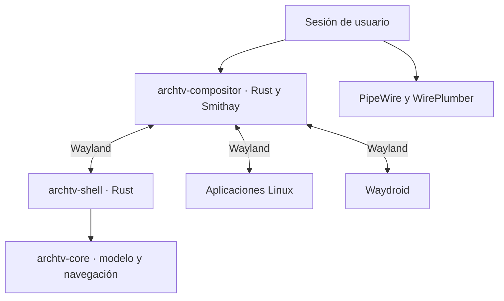

# Arquitectura objetivo

Estado: compositor, núcleo de foco, supervisión y cliente de prueba implementados;
shell de televisión implementado y en validación H5. El alcance inicial es un equipo
x86_64 UEFI, un monitor y una aplicación principal a pantalla completa.

| Componente previsto | Responsabilidad | Límite |
| --- | --- | --- |
| archtv-compositor | DRM/KMS o backend de pruebas, superficies, frames, asiento, entrada, foco y activación. | Sin catálogos, red ni carga de imágenes en su bucle crítico. |
| archtv-shell | Inicio, tarjetas, favoritos, búsqueda, teclado en pantalla y paneles. | Cliente Rust reiniciable; su fallo no debe cerrar las aplicaciones. |
| archtv-core | Modelo de aplicaciones, estado persistente y navegación espacial. | Lógica comprobable sin GPU ni sesión gráfica. |
| archtv-session | Arranque, supervisión, entorno y recuperación. | Usuarios y servicios se gestionan mediante las herramientas del sistema. |
| Waydroid | Contenedor, imagen y ejecución Android. | Su estado se informa al shell sin bloquear el inicio. |

Los nombres describen responsabilidades. El compositor y el núcleo existen como
crates; todavía no hay paquetes instalables del producto. La supervisión reside
en el compositor y el entorno se valida con una sesión PAM temporal.

## Decisiones iniciales

- Conservar la identidad Arch TV y la referencia de Fire TV 2026 con navegación superior.
- Rust para el compositor, la interfaz y el modelo. Smithay es la biblioteca del
  compositor; Anvil se estudia como referencia y Smallvil como ejemplo mínimo.
- Shell separado para contener fallos. Evaluar Smithay Client Toolkit y una ruta
  de dibujo/texto CPU para el shell, con un ensayo antes de fijar dependencias.
- Pantalla completa y retorno Inicio como política principal; escritorio flotante,
  varios monitores y Xwayland no son requisitos de la primera entrega.
- Seleccionar protocolos y backends explícitamente. Una opción de compilación
  habilitada no equivale a una ruta de presentación probada.
- La sesión propia arranca como usuario normal y retira capacidades heredadas
  innecesarias. La prueba previa identificó CAP_WAKE_ALARM como origen de un
  conflicto con bubblewrap; conservar esta comprobación en la nueva sesión.

## Entrada y control

Inicio se reserva para recuperar el shell. Las flechas y Volver se entregan al
cliente activo cuando no hay un panel propio abierto. El estado de foco recuerda
fila y tarjeta y se restaura al retornar de una aplicación.

El canal de control de la sesión identifica al shell mediante una conexión
privada heredada; se entrega junto con una conexión Wayland con rol de shell. No exponer
lanzamiento de procesos ni gestión de servicios a cualquier cliente Wayland.
Las acciones de volumen, red y suspensión se ejecutan fuera del bucle de frames.
Gamepad, mandos Bluetooth y HDMI-CEC requieren pruebas e integración específica.

## Dependencias compartidas

Mesa, Wayland, libinput, DRM, libseat y las bibliotecas de texto/imagen se evaluarán
según los backends elegidos. PipeWire, NetworkManager y Waydroid siguen siendo
servicios del sistema. Las bibliotecas GTK que necesite Waydroid no convierten
la interfaz propia en una aplicación GTK.

Los hitos y criterios que validan estas decisiones están en [ROADMAP.md](../ROADMAP.md).
