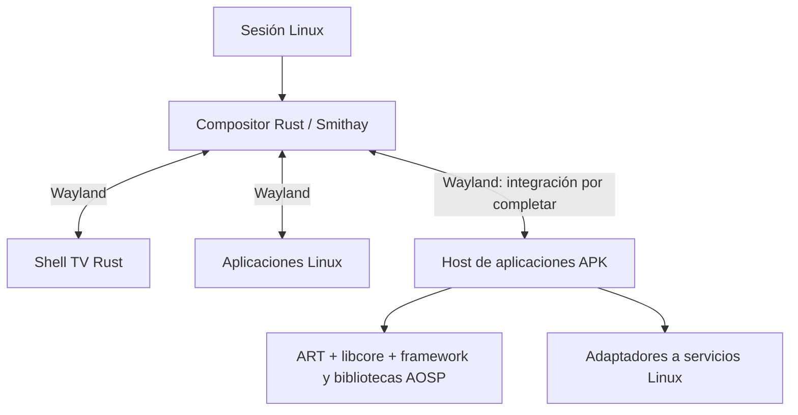
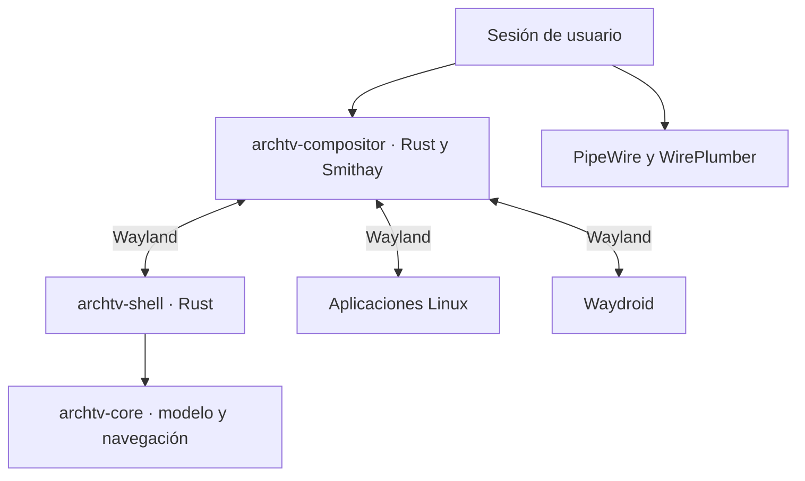

# Arquitectura vigente

## Decisión BASE-AOSP-1 · evaluación de base x86_64 (2026-10-30)

El [contrato vigente](CONTRATO-APK.md) mantiene APK sin modificar y Linux/Smithay,
sin Waydroid ni Android completo. **La base definitiva no está elegida.** Se
prioriza medir una selección coherente Bionic/AOSP original (B) antes de seguir
ampliando adaptaciones por métodos. ART host (A) queda como comparación reproducible,
no como arquitectura obligatoria. Una combinación (C) necesita fronteras probadas.
Estado/checkpoint: [ESTADO.md](ESTADO.md); aceptación: [ROADMAP-A.md](ROADMAP-A.md).

### Qué significa AOSP x86_64 oficial

AOSP publica código/targets para x86_64; la guía oficial de
[Cuttlefish](https://source.android.com/docs/devices/cuttlefish/get-started)
identifica `aosp_cf_x86_64_only_phone` y artefactos en Android CI. Cuttlefish es
un dispositivo virtual de referencia, no una biblioteca de compatibilidad Linux.
[Android Emulator](https://developer.android.com/studio/run/emulator) es otra
herramienta de dispositivo virtual para desarrollo de apps. Descargar sus imágenes
como input de estudio no exige ejecutarlas. No se han instalado ni arrancado.

El [proyecto Android-x86](https://www.android-x86.org/) mantiene su propio port y
fuentes: se distingue de los targets y artefactos del árbol oficial AOSP. El
[NDK enumera x86_64](https://developer.android.com/ndk/guides/abis) entre sus ABI;
esto no convierte glibc en Bionic ni traduce instrucciones ARM. Tampoco garantiza
que una APK arbitraria incluya una biblioteca x86_64 o que sus servicios existan.

Artefactos ya comprobados: imagen oficial SDK `default;x86_64` API 33 revisión 2,
SHA-256 `297a7384…aa5bc22`, fingerprint TE1A.220922.034/10940250; sistema/APEX,
recursos y 31 jars con DEX y fragmentos originales de bootclasspath. Procedencia
completa en [platform-image.json](../runtime/aosp/platform-image.json) y
[extracción](../reports/aosp-platform-bootstrap/artifact-index.json). No son stubs.
`android.jar`, android-all de compilación y snapshots SDK con `*-stubs.jar` no
son sustitutos de esas implementaciones. API 33 y parche 2022-11-05 de esta imagen
son referencia histórica fijada, no aceptación de seguridad/actualización del producto.
No se ha validado una build reciente Cuttlefish ni su cierre mínimo. La caché SDK
no implica autorización de redistribución: H8 debe revisar licencias/NOTICE y, si
procede, producir componentes desde fuentes fijadas de una build mantenida.

### Comparación de estrategias y mezclas actuales

| Ruta | Reutilización y frontera | Evidencia actual | Dependencias/costes y experimento decisivo |
| --- | --- | --- | --- |
| A · host glibc | ART/libcore host, androidfw y subsistemas JNI recompilados; puente Rust/Linux. | Fixtures funcionales; framework modular llega a ContextImpl. Ensayo JNI pendiente lee manifiesto y falla por PermissionManager. | Coste de port/ABI/classloader y servicios propio. Repetir Markor completa con JNI/servicios por subsistemas; medir mantenimiento y recursos. No extender Activity/widgets propios para dar apariencia de compatibilidad. |
| B · nativo Bionic | ART/libcore, Bionic/linker, framework, APEX, JNI y recursos del mismo target/build; procesos Linux supervisados, interfaces gráficas/entrada/servicios adaptadas. | Linker Bionic --help/--list pasa. ART target se invoca y aborta por public.libraries.txt omitido; no DEX ni app ejecutados. | Namespaces/rutas/APEX, propiedades, TLS/bionic, Binder, permisos, SELinux/seccomp/cgroups esperados, fonts, HAL/BufferQueue/servicios. Primero loader/ART aislado, después runtime original y cierre de servicios de Markor. Puede conservar más semántica; no se presupone menor coste ni funcionamiento. |
| C · mezcla controlada | Componentes Bionic y host en procesos separados, protocolo versionado de buffers/entrada/servicios; o frontera intraproceso demostrada. | Ninguna combinación aceptada para APK reales. Mezcla actual sólo experimental. | Probar ABI, identidad, ownership, hilos, excepciones, FD y caídas. No pasar objetos C++/JNI entre libc o VM por coincidencia de ISA/nombres. Medir copias, latencia y complejidad. |

La mezcla real no equivale aún a B ni a C aprobadas:

- ART/libcore/core JNI host: export R8 de Android 13 r3, enlazado para glibc.
- 24 jars no básicos de la imagen SDK Android 13 r2 en classpath de aplicación,
  con siete jars core del host. Hay dos builds y el framework no está situado como
  en su bootclasspath original. Identidad del classloader, reflexión y JNI sólo
  tienen pruebas parciales, no una validación general.
- androidfw/recursos JNI originales fijados a sus manifiestos de fuentes, compilados
  para host con libc++ del bundle ART; no son binarios Bionic de la imagen SDK.
  El experimento nuevo registra cuatro unidades originales sin modificar, pero
  sigue sin commit y separado de esta revisión. Sus fuentes no se presuponen
  idénticas a la build SDK: el registro JNI y parseo probado sólo contrastan esa ruta.
- `libarchtv_aosp_linux.so` y registro local son adaptadores propios. El Binder
  local no acredita IPC ni autorización Android. El contador usa UI propia;
  todavía no hay ventana de Markor con vistas originales.

Alternativa existente para A: [ATL](https://gitlab.com/android_translation_layer/android_translation_layer/-/raw/master/README.md)
y [art_standalone](https://gitlab.com/android_translation_layer/art_standalone).
Upstream documenta ART/dependencias AOSP adaptadas a Linux y un enlazador de
traducción para JNI. Su README también describe APIs incompletas, stubs y widgets
GTK: no acredita nuestra matriz ni justifica respuestas ficticias. Antes de más
port host, fijar revisión/licencias y evaluar sus componentes y el mismo recorrido
Markor, no sólo demos upstream. No se ha descargado/instalado/ejecutado ATL en esta
revisión. Esta comparación puede reducir reimplementación; no cambia la prioridad
de probar cierres A/B ni convierte una compatibilidad de API en traducción ISA.

[libhybris](https://github.com/libhybris/libhybris/blob/master/README.md) es una
alternativa existente para cargar bibliotecas basadas en Bionic desde host Linux;
no implementa framework/servicios APK ni traduce ISA. Se evaluará sólo si una
frontera intraproceso lo requiere, comparando versión de Bionic/TLS/enlazador,
JNI y ownership. No está instalado ni probado aquí. Un proceso Bionic separado
permite evitar asumir esa compatibilidad intraproceso, pero necesita su propio
cierre de dependencias e IPC.

### Componentes, procesos y cierre mínimo

Esta tabla clasifica hipótesis de reutilización, no promete que los binarios ya
funcionen fuera de su sistema. Cada fila requiere manifiesto de dependencias y
pruebas de inicio, operación, denegación, caída, cierre y costes.

| Subsistema original | Posible unidad sobre Linux | Dependencias/puerta |
| --- | --- | --- |
| Bionic/linker | Proceso ELF propio; libc/libm/libdl dentro de ese entorno | ABI/TLS, rutas y namespaces originales; syscalls y políticas del host. No cargar libc.so Android como sustituto de libc.so.6. |
| ART/libcore | dalvikvm/launcher y bibliotecas del mismo APEX/build | Bootclasspath original, ICU/Conscrypt, JNI/core, propiedades y entorno. Ejecutar DEX semántico es sólo puerta preparatoria. |
| Framework/APEX/recursos | Jars/recursos y bibliotecas cargados por ese runtime | APEX son unidades de componentes, no servicios mágicos; extraerlos no inicia apexd ni cumple actualización/firma. Mantener metadatos/versiones coherentes. |
| libandroid_runtime/androidfw/XmlBlock/AssetManager | Subsistema JNI original, con registro y ownership íntegros | Clases de la misma build, nativehelper, Bionic y bibliotecas transitivas. En host exige adaptación y pruebas; no mezclar tokens propios con punteros originales. |
| Package/Permission/Activity/Content services | Reutilización de lógica/servicios individuales o proceso Java especializado | Binder/registro, identidades/UID, datos, permisos, settings y otras dependencias reales; no inyectar éxito vacío. Averiguar si pueden separarse de system_server sin romper contrato. |
| Binder/servicemanager | IPC kernel/daemon de nombres o adaptación de protocolo justificada | Dispositivo/namespace, credenciales, políticas, muerte y FD. Kernel Linux compartido no prueba driver/política disponibles ni autoriza a desactivar aislamiento. |
| HWUI/Skia/Surface/BufferQueue | Renderizador original y puente a buffers Wayland | Fonts, allocator/mapper, sync/fences, EGL/Vulkan y ciclo de superficies. Smithay conserva composición/foco. SurfaceFlinger/HWC originales no se arrancan como escritorio Android de fondo. |
| Audio/media/codec | Bibliotecas originales y servicios limitados o adaptadores a PipeWire/Mesa | Selección de backend, Binder/HAL, rutas audio/video, synchronización y DRM; medir reproducción real en VLC y permisos/proveedor. |
| Red/almacenamiento/proveedores | Libcore y servicios con adaptación Linux | DNS/TLS/keystore, SQLite/datos, ContentResolver/URI grants/persistencia y proveedores locales/remotos. No sustituir una URI por un path sin probar su semántica. |
| Zygote/system_server/init | No se asumen requisitos globales ni se eliminan por decreto | [Zygote](https://source.android.com/docs/core/runtime/zygote) forma parte de la gestión de procesos Android. Cualquier reutilización limitada debe demostrar cierre. Si sólo funciona la cadena completa, es conflicto con C1–C7, no permiso para boot oculto. |

[APEX](https://source.android.com/docs/core/ota/apex) agrupa runtime, bibliotecas y
servicios; su mecanismo de activación/actualización es distinto de copiar archivos.
El [linker Android](https://source.android.com/docs/core/architecture/vndk/linker-namespace)
usa configuración de namespaces generada en Android moderno. Para B habrá que
reproducir ese contrato mínimo de entorno o generar una configuración equivalente
verificada; no asumir que `LD_LIBRARY_PATH` acredita la plataforma.

[BufferQueue/Gralloc](https://source.android.com/docs/core/graphics/arch-bq-gralloc)
y el [framework multimedia](https://source.android.com/docs/core/media) explican
por qué una biblioteca con símbolos resueltos todavía necesita buffers, sync,
servicios y backends. La selección de componentes debe hacer explícitas esas
fronteras, evitando tanto arrancar Android entero como reescribir sus algoritmos.

### Servicios externos/propietarios y tres ejes de compatibilidad

El catálogo canónico está en la [matriz](COMPATIBILIDAD-APK.md), incluyendo evidencia
REA y requisitos de prueba por función. Se mantienen tres ejes independientes:
API/servicio; ABI Bionic/JNI; ISA. El [Native Bridge de AOSP](https://android.googlesource.com/platform/art/+/refs/heads/main/libnativebridge/README.md)
permite integrar un traductor, pero AOSP no proporciona uno. No hay traducción ARM
probada aquí; se requiere otra puerta con APK ARM-only y dependencias reales.

[Google Play services](https://developers.google.com/android/guides/overview) y
[GMS](https://www.android.com/gms/) no quedan incluidos por reutilizar AOSP;
GMS es externo y requiere licencia. [microG](https://github.com/microg/GmsCore)
se evaluará antes de reimplementar contratos, atendiendo a su
[cobertura declarada por API](https://github.com/microg/GmsCore/wiki/Implementation-Status)
y [requisitos de identidad](https://github.com/microg/GmsCore/wiki/Signature-Spoofing).
No está probado sobre esta capa ni sustituye cuentas, backend o certificación.
El [Play Integrity API](https://developer.android.com/google/play/integrity/overview)
usa señales verificadas y puede exigir confianza de hardware; no se generarán
veredictos ficticios. Autenticación, FCM, mapas, billing e integridad se probarán
separados con APK concretas y pruebas de error/offline; los tres APK actuales no
cubren GMS. Se buscará un APK real distribuido por su autor para ese perfil.

[Widevine](https://developers.google.com/widevine/drm/overview) requiere integración
y licencias; provisioning/keybox/OEMCrypto y el servicio de licencias del proveedor
no se sustituyen con una interfaz local. [Media3](https://developer.android.com/media/media3/exoplayer/drm)
usa MediaDrm y esquemas concretos: ClearKey no acredita Widevine/PlayReady ni vídeo
protegido por hardware. Faltan APK real/versión, contenido y acceso de prueba para
DRM comercial. Su ausencia se registra como cobertura pendiente, no como éxito ni
imposibilidad universal. Sin prueba de esas condiciones no se promete el catálogo
comercial. No se alteran APK ni se evaden certificaciones para ocultar límites.

Markor incluye DocumentFile/TreeDocumentFile: REA observa createDocument mediante
ContentResolver y referencias desde NewFileDialog/otros componentes. Esa evidencia
es estática, no acredita que una ruta se haya ejecutado. SAF implica proveedor y
grants; un proveedor de nube requiere además su autenticación/backend. En VLC,
REA observa `MediaPlayer.play()`→`nativePlay()` y espera de superficies; el JNI y
libVLC originales necesitan resolución binaria, salida audio/video y servicios.
Una referencia DEX a MediaDrm en Markor/Calculator no demuestra reproducción DRM:
la ruta exacta sigue por investigar. No se atribuye Widevine a esas apps por ese tipo.

### Decisión operativa y prueba vertical

Siguiente experimento: inventario y ejecución acotada del linker/ART target Bionic
original bajo supervisión Linux, sin init/boot Android; luego bootstrap Markor con
cierre explícito de Package/Permission/Content/Activity y presentación/entrada
Smithay. A conserva el ensayo y fallo reales como comparación. No se añadirá un
stub PermissionManager que devuelva una lista vacía para dar por parseada la APK.

La elección A/B/C se realizará al comparar las seis etapas del recorrido Markor,
identidad/clase/ABI, dependencias y coste total; una prueba parcial sólo decide
el siguiente riesgo a investigar. Si B necesita un conjunto de servicios equivalente
a Android completo, documentar esa tensión y estudiar separación/adaptación antes
de cambiar el objetivo. Los detalles de ejecución y puertas están en ROADMAP-A.

## Evidencia anterior conservada (no fija la base elegida)

Estado del experimento anterior: el [framework modular original](../reports/aosp-platform-bootstrap/result.json)
supera SystemServiceRegistry/ContextImpl. PackageParser original se detiene en
ApkAssets.nativeOpenXml, sin ejecutar código de Markor. Se reutilizará el
subsistema JNI original de recursos, conservando su ownership; no se sustituirá
la semántica de parseo del manifiesto por una implementación propia.

Los componentes no básicos proceden juntos de una imagen AOSP API 33 r2
(fingerprint TE1A.220922.034/10940250), extraída sin montar ni arrancar Android.
31 jars tienen DEX ejecutable; el ensayo usa 24 no básicos en classpath de
aplicación con core/libcore/JNI de ART host r3. Esta frontera de build y
classloader no es una plataforma coherente completa ni una ABI validada.
Las versiones, orden original de fragmentos y hashes quedan en el
[inventario](../reports/aosp-platform-bootstrap/bootclasspath.json). El snapshot
SDK de Connectivity con stubs sigue descartado como implementación. La imagen
es input de estudio; distribución/licencias/actualización del runtime siguen abiertas.
Aislamiento: sólo preflight parcial, no aceptación de seguridad.

Esta sección sustituye las decisiones antiguas de backend Android que se conservan
al final como historia. Estado operativo: [ESTADO.md](ESTADO.md). Requisitos y
aceptación: [ROADMAP.md](../ROADMAP.md). Evidencia: [EVIDENCIAS.md](EVIDENCIAS.md).

El host APK actual combina código original y un prototipo de API propia. La
ventana del contador se representa desde su árbol propio; construir/layout de
View AOSP en otro proceso no demuestra que esa vista dibuje la APK. La flecha
APK del diagrama es el diseño objetivo, no una integración completa acreditada.

| Decisión del experimento anterior | Justificación/evidencia | Trabajo abierto |
| --- | --- | --- |
| Compositor y shell Rust separados | Política TV y recuperación H4/H5; evitar bloquear el bucle gráfico con servicios. | Medición H7, mandos físicos y accesibilidad. |
| Reutilizar ART/libcore y lógica original AOSP cuando corresponda | DEX, cola, recursos y perfiles nativos existentes; ver índice. | Decidir conjunto coherente de runtime/framework/servicios y ABI. |
| Adaptar fronteras Linux/Wayland | El producto usa Smithay, PipeWire y servicios Linux. | Gráficos APK, lifecycle completo, permisos e IPC/servicios necesarios. |
| Activity/widgets/árbol propios son experimentales | Sirven al contador y sus regresiones, no prueban compatibilidad general. | Evaluar sustitución por componentes originales; no extenderlos por inercia. |
| Sin Waydroid ni boot Android completo | Restricción del objetivo original y reconducción del usuario. | Reutilizar servicios/componentes no obliga a lanzar una imagen Android. |
| Identidad/aislamiento por APK siguen pendientes | UID Linux 1000 puede colisionar con SYSTEM_UID Android; consultar permisos denegados no impone aislamiento. | Modelo de usuarios/capacidades y defensa antes de APK no confiables. |

## Revisión de reutilización · 30 de octubre de 2026

El [informe de artefactos](../reports/arquitectura-apk-20261030/compatibility-matrix.json)
y [la comparación DEX](../reports/arquitectura-apk-20261030/dex-classspace-comparison.json)
separan observaciones estáticas, enlace de clases y ejecución. La matriz humana
está en [COMPATIBILIDAD-APK.md](COMPATIBILIDAD-APK.md).

| Frontera | Reutilización/adaptación actual | Decisión y evidencia |
| --- | --- | --- |
| Ejecución DEX | ART/libcore host del bundle R8 verificado. | Conservar como laboratorio. No confundir ART con toda la plataforma Android. |
| Framework Java | Perfil selectivo original más Activity/widgets/vistas propios. | Congelar ampliación de esos sustitutos; evaluar el framework DEX original coherente del mismo bundle. |
| Bootstrap | Main crea Application predeterminada y llama hostCreate/hostDestroy sobre Activity propia. | No respeta aún Application declarada ni todo el lifecycle/LoadedApk/providers. Resolver el lanzamiento original como subsistema. |
| Gráficos | Skia/HWUI/Minikin originales y puente Wayland propio; UI del contador basada en árbol propio. | Conservar Skia/HWUI y adaptar presentación/entrada. No reconstruir el catálogo de widgets Android en Rust ni interpretar APK como una pantalla propia. |
| Servicios | Cola/log/recursos y contratos originales; registro local de prueba sin commit. | Adaptación Linux válida como experimento local, no sustituto completo de Binder/servicemanager/PackageManager. Evaluar servicios AOSP originales por conjuntos y sus IPC necesarios. |
| Preferencias/archivos | Backend propio de enteros para fixture. | No ampliarlo como SharedPreferences/almacenamiento Android general; evaluar implementación original y permisos/volúmenes/URI con el recorrido real. |
| ABI nativa | Bibliotecas host glibc. | No cargan automáticamente las bibliotecas Bionic de una APK: comprobar linker, ABI, símbolos, TLS y dependencias, no renombrar libc. |

### Evidencia que cambia la ruta del framework

El bundle oficial R8 registrado en reports/a1-art-host/source.json contiene
framework.jar (37.051.014 bytes; cuatro DEX), services.jar y framework-res.apk.
No son android-all/Robolectric. El inventario de candidatos guarda sus hashes;
queda por confirmar la revisión exacta de cada build y el conjunto completo de
bootclasspath/módulos antes de distribuirlo.

El framework.jar define 26.676 tipos frente a 518 del perfil selectivo examinado.
Markor referencia estáticamente 789 tipos Android externos a su APK; 688 no están
definidos en el perfil selectivo y 39 no están en ese único framework.jar.
Calculator: 594/495/30; VLC: 893/793/40. Esos números no incluyen reflexión ni
resolución de miembros. Algunos tipos pueden estar en otros módulos/boot jars o
ser API más nueva guardada por comprobaciones de versión: no equivalen a fallos
de ejecución ni a un porcentaje de compatibilidad.

El [ensayo ART](../reports/arquitectura-apk-20261030/framework-space/result.json)
usa únicamente framework.jar, la APK original y un probe de reflexión, sin las
clases Android del prototipo. Enlaza Application, Activity, View, LayoutInflater
y las Activity de Markor/Calculator con Class.forName initialize=false; ambas son
subtipos de Activity original. No ejecuta Application/onCreate ni dibuja nada.
La decisión es probar este conjunto coherente en el bootstrap real, conservando
el perfil selectivo como regresión, no seguir cerrando clases ausentes una a una.

### Bionic, libhybris y servicios originales

Bionic incluye libc, libm, libdl y el enlazador Android; su [documentación original](https://android.googlesource.com/platform/bionic/+/master/README.md)
explica su reparto. Las bibliotecas x86_64 de VLC declaran libc.so/libdl.so/libm.so
más liblog/EGL/GLES; el holder host declara libc.so.6/libm.so.6 y libc++ host.
REA identifica notas Android y el hash ELF; readelf registra DT_NEEDED por separado.
Compartir ISA no resuelve esa frontera ABI.

Se compararán dos experimentos antes de fijar la entrega nativa: un entorno de
proceso Bionic coherente con ART/bibliotecas originales y un adaptador de carga
sobre el host glibc. [libhybris](https://github.com/libhybris/libhybris/blob/master/README.md)
es candidato para bibliotecas Bionic/abstracción de hardware; su documentación
requiere adaptaciones y servicios específicos. No proporciona por sí mismo ART,
framework/lifecycle de APK ni traducción ARM, y no se instala como supuesto remedio.
Su utilidad debe probarse con bibliotecas concretas y sus dependencias.

Tampoco se deduce que haya que arrancar Android: se pueden reutilizar bibliotecas
y procesos/servicios necesarios sin SystemUI, SurfaceFlinger ni init de un Android
completo. Queda por demostrar qué servicios originales pueden ejecutarse aislados
con sus dependencias. El registro local experimental no ofrece IPC entre procesos,
callbacks de registro, administración de paquetes ni seguridad Android completa;
no debe crecer por inercia hasta reimplementar todo servicemanager.

### Arquitecturas y aislamiento

Los tres casos adquiridos tienen ruta x86_64 o no incluyen JNI propio. No requieren
traducción de ISA para este primer estudio. [ART Native Bridge](https://android.googlesource.com/platform/art/+/refs/heads/main/libnativebridge/README.md)
es una interfaz y AOSP no incluye un traductor real. [QEMU user](https://www.qemu.org/docs/master/user/main.html)
permite estudiar procesos de otra ISA y traducción de syscalls, con límites de
hilos/namespace e ioctl: no equivale a cargar una biblioteca ARM en ART x86_64.
Para APK sólo ARM hay que evaluar puente y linker invitados o proceso ART de la
ISA invitada. Rendimiento, Binder/gráficos y redistribución quedan sin demostrar.

Antes de ejecutar recorridos completos se debe comprobar aislamiento real de
archivos/procesos/IPC/red y la identidad por APK. Conservar UID Linux 1000 puede
activar ramas SYSTEM_UID de AOSP; devolver permisos denegados no corrige ese
problema ni protege recursos. No se fingirá un UID o un permiso para avanzar.
La solución de identidad debe medirse junto con el backend de servicios.

### Prioridad de ejecución

Primer recorrido propuesto: Markor sin modificar, nota local → edición con teclado
→ guardar → cerrar → reabrir. No tiene .so en lib/ según el inventario; la carga dinámica no está descartada y depende de
servicios/bibliotecas del framework. Después Calculator (alias de lanzador,
widgets e historial) y VLC (JNI, audio/vídeo/foreground services). Para cada caso
se registran lanzamiento, interfaz, entrada, persistencia, servicios y cierre por
separado. Ampliar a WebView, ARM, splits y servicios propietarios sigue requerido;
no se redefine compatibilidad amplia como esos tres recorridos.

Siguiente acción: verificar la procedencia/bootclasspath del framework candidato
y ensayar bootstrap original de Application/Activity, permisos e integración de
ventana en un proceso aislado. No arrancar Waydroid ni un Android completo.
Mantener H7–H9/A3–A5 abiertos: instalar/actualizar/recuperar el runtime y medir
estabilidad/ligereza del producto siguen siendo puertas de salida.

## Antecedentes históricos (no son decisiones vigentes)

La arquitectura anterior queda conservada a continuación para interpretar las
pruebas H6. Sus afirmaciones de Waydroid como backend inicial, paquetes aún no
creados y estado H5 son históricas y no prevalecen sobre la sección anterior.

### Arquitectura objetivo anterior

Estado: compositor, núcleo de foco, supervisión y cliente de prueba implementados;
shell de televisión implementado y en validación H5. El alcance inicial es un equipo
x86_64 UEFI, un monitor y una aplicación principal a pantalla completa.

| Componente previsto | Responsabilidad | Límite |
| --- | --- | --- |
| archtv-compositor | DRM/KMS o backend de pruebas, superficies, frames, asiento, entrada, foco y activación. | Sin catálogos, red ni carga de imágenes en su bucle crítico. |
| archtv-shell | Inicio, tarjetas, favoritos, búsqueda, teclado en pantalla y paneles. | Cliente Rust reiniciable; su fallo no debe cerrar las aplicaciones. |
| archtv-core | Modelo de aplicaciones, estado persistente y navegación espacial. | Lógica comprobable sin GPU ni sesión gráfica. |
| archtv-session | Arranque, supervisión, entorno y recuperación. | Usuarios y servicios se gestionan mediante las herramientas del sistema. |
| Waydroid | Contenedor, imagen y ejecución Android. | Su estado se informa al shell sin bloquear el inicio. |

Los nombres describen responsabilidades. El compositor y el núcleo existen como
crates; todavía no hay paquetes instalables del producto. La supervisión reside
en el compositor y el entorno se valida con una sesión PAM temporal.

## Decisiones iniciales

- Conservar la identidad Arch TV y la referencia de Fire TV 2026 con navegación superior.
- Rust para el compositor, la interfaz y el modelo. Smithay es la biblioteca del
  compositor; Anvil se estudia como referencia y Smallvil como ejemplo mínimo.
- Shell separado para contener fallos. Evaluar Smithay Client Toolkit y una ruta
  de dibujo/texto CPU para el shell, con un ensayo antes de fijar dependencias.
- Pantalla completa y retorno Inicio como política principal; escritorio flotante,
  varios monitores y Xwayland no son requisitos de la primera entrega.
- Seleccionar protocolos y backends explícitamente. Una opción de compilación
  habilitada no equivale a una ruta de presentación probada.
- La sesión propia arranca como usuario normal y retira capacidades heredadas
  innecesarias. La prueba previa identificó CAP_WAKE_ALARM como origen de un
  conflicto con bubblewrap; conservar esta comprobación en la nueva sesión.

## Entrada y control

Inicio se reserva para recuperar el shell. Las flechas y Volver se entregan al
cliente activo cuando no hay un panel propio abierto. El estado de foco recuerda
fila y tarjeta y se restaura al retornar de una aplicación.

El canal de control de la sesión identifica al shell mediante una conexión
privada heredada; se entrega junto con una conexión Wayland con rol de shell. No exponer
lanzamiento de procesos ni gestión de servicios a cualquier cliente Wayland.
Las acciones de volumen, red y suspensión se ejecutan fuera del bucle de frames.
Gamepad, mandos Bluetooth y HDMI-CEC requieren pruebas e integración específica.

## Dependencias compartidas

Mesa, Wayland, libinput, DRM, libseat y las bibliotecas de texto/imagen se evaluarán
según los backends elegidos. PipeWire, NetworkManager y Waydroid siguen siendo
servicios del sistema. Las bibliotecas GTK que necesite Waydroid no convierten
la interfaz propia en una aplicación GTK.

Los hitos y criterios que validan estas decisiones están en [ROADMAP.md](../ROADMAP.md).

## Evolución del entorno Android

La dirección futura es un entorno propio basado en AOSP, compartiendo el kernel
Linux e integrado con Rust/Smithay. Waydroid sirve de backend inicial y referencia
funcional. El contrato de aplicaciones deberá permitir sustituirlo sin rehacer
el shell. Véase [AOSP-NATIVO.md](AOSP-NATIVO.md) para etapas, requisitos de ART,
Binder/framework/HAL, ABIs y criterios para retirar la dependencia.
